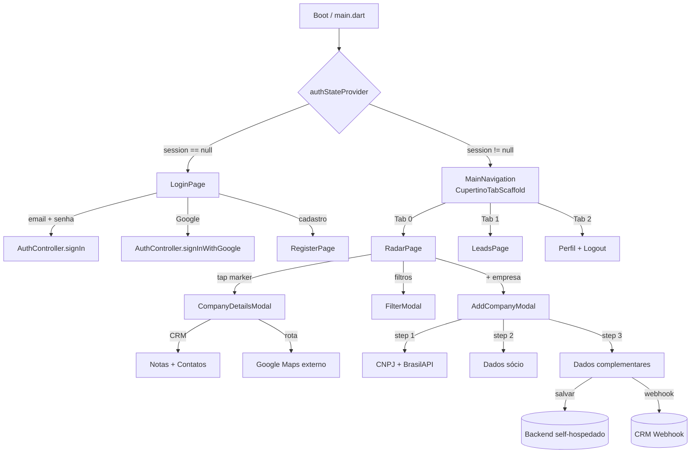

# RUMO App — Guia de Arquitetura

## Stack

| Camada | Tecnologia |
|---|---|
| UI | Flutter + Cupertino Widgets |
| State management | Riverpod 2 (Notifier + FutureProvider) |
| Autenticação | Firebase Auth (+ Crashlytics e Analytics) |
| Backend de dados | Self-hospedado: PostgreSQL + PostGIS exposto via PostgREST, com serviço Python (FastAPI, padrão MVC) auxiliar — atrás de um proxy Caddy |
| Mapa | Google Maps Flutter (com fallback pra OpenStreetMap via `flutter_map` quando não há chave/ela falha — ver [Fallback de mapa](#fallback-de-mapa)) |
| CRM | HubSpot (via `CrmService` — nome agnóstico de fornecedor, ver [Backend self-hospedado](#backend-self-hospedado)) |
| API externa | BrasilAPI (dados de CNPJ, via `CompanyLookupService`) |
| Deploy | Docker + nginx (Flutter Web, local) + Docker Compose (backend self-hospedado)¹; em produção o Caddy da EC2 serve o Flutter Web e o APK (ver [Frontend em produção](#frontend-em-produção-flutter-web--apk)) |

¹ Backend self-hospedado roda local via Docker Compose, ou em produção numa instância EC2
`t3.micro` provisionada via CloudFormation (`infra/aws/backend-stack.yaml`) — ver seção
"Backend self-hospedado" mais abaixo.

---

## Estrutura de diretórios

```
lib/
├── main.dart                          # Inicialização (Firebase) + roteamento por authState
├── firebase_options.dart              # Config do Firebase (gerada via `flutterfire configure`)
│
├── core/
│   ├── app_config.dart                # Variáveis de ambiente (--dart-define-from-file)
│   └── services/
│       ├── api_client.dart            # Cliente HTTP do backend novo: troca idToken do
│       │                              # Firebase por JWT interno e fala com PostgREST/
│       │                              # FastAPI (get/post/upsert/rpc/backend)
│       └── analytics_service.dart     # Provider do FirebaseAnalytics
│
└── features/
    ├── auth/                          # Autenticação e perfil do usuário
    │   ├── login_page.dart
    │   ├── register_page.dart
    │   ├── privacy_policy_page.dart
    │   ├── firebase_auth_messages.dart # Tradução de FirebaseAuthException pra pt-BR
    │   └── providers/
    │       ├── auth_provider.dart     # authStateProvider (Firebase idTokenChanges) +
    │       │                          # AuthController (signIn/signUp/signInWithGoogle)
    │       └── profile_provider.dart  # profileProvider + UserProfile model (via ApiClient)
    │
    ├── map/                           # Feature principal: mapa + radar de empresas
    │   ├── radar_page.dart            # Página do mapa (GoogleMap + bottom list)
    │   ├── models/
    │   │   └── company_model.dart     # Model Company (vem da RPC search_companies)
    │   ├── providers/
    │   │   ├── company_provider.dart  # companiesProvider (FutureProvider)
    │   │   ├── location_provider.dart # locationProvider (GPS com fallback)
    │   │   ├── filter_provider.dart   # MapFiltersNotifier + filterOptionsProvider
    │   │   └── map_backend_provider.dart # useGoogleMapsProvider: Google Maps ou fallback OSM
    │   ├── widgets/
    │   │   └── osm_map.dart           # OsmMap (flutter_map) usado quando o Google Maps não está disponível
    │   ├── services/
    │   │   ├── company_service.dart   # Chamadas RPC via ApiClient (backend self-hospedado)
    │   │   └── tracking_service.dart  # Rastreamento de localização via ApiClient (timer 5 min)
    │   ├── data/
    │   │   └── company_repository.dart # Repository pattern (ICompanyRepository)
    │   └── presentation/
    │       ├── radar_viewmodel.dart   # Estado de UI do bottom sheet
    │       ├── filter_modal.dart      # Modal de filtros avançados
    │       └── company_details_modal.dart # Detalhes da empresa + CRM
    │
    ├── leads/                         # Feature de busca textual de leads
    │   ├── leads_page.dart
    │   └── leads_search_provider.dart # leadsSearchQueryProvider + leadsResultsProvider
    │
    └── company/                       # Cadastro de novas empresas
        ├── add_company_modal.dart     # Multi-step modal (3 passos)
        ├── crm_service.dart           # Integração com o CRM via ApiClient (nome
        │                              # agnóstico de fornecedor — hoje é o HubSpot)
        ├── registration_service.dart  # Consulta de CNPJ (via ApiClient) +
        │                              # geocoding + upsert em `companies` via ApiClient
        └── constants.dart             # Dropdowns: departamentos, setores, regimes, etc.
```

---

## Diagrama de providers

```mermaid
graph TD
    AUTH[authStateProvider<br/>StreamProvider&lt;AuthState&gt;]
    CTRL[authControllerProvider<br/>Provider&lt;AuthController&gt;]
    PROFILE[profileProvider<br/>FutureProvider&lt;UserProfile?&gt;]

    LOC[locationProvider<br/>FutureProvider&lt;Position&gt;]
    FILTERS[mapFiltersProvider<br/>NotifierProvider&lt;MapFilters&gt;]
    FILTER_OPTS[filterOptionsProvider<br/>FutureProvider&lt;Map&gt;]
    CITIES[filteredCitiesProvider<br/>Provider&lt;List&lt;String&gt;&gt;]
    REPO[companyRepositoryProvider<br/>Provider&lt;ICompanyRepository&gt;]
    COMPANIES[companiesProvider<br/>FutureProvider&lt;List&lt;Company&gt;&gt;]

    RADAR_VM[radarViewModelProvider<br/>NotifierProvider&lt;RadarUiState&gt;]
    TRACKING[trackingServiceProvider<br/>Provider&lt;TrackingService&gt;]

    SEARCH_Q[leadsSearchQueryProvider<br/>StateProvider&lt;LeadsSearchQuery&gt;]
    LEADS[leadsResultsProvider<br/>FutureProvider&lt;List&lt;Company&gt;?&gt;]

    HS_NOTES[crmNotesProvider.family<br/>FutureProvider&lt;List&lt;CrmNote&gt;&gt;]
    HS_CONTACTS[crmContactsProvider.family<br/>FutureProvider&lt;List&lt;CrmContact&gt;&gt;]

    LOC --> COMPANIES
    FILTERS --> COMPANIES
    REPO --> COMPANIES
    FILTERS --> FILTER_OPTS
    FILTERS --> CITIES

    COMPANIES --> RADAR_VM

    FILTERS --> LEADS
    REPO --> LEADS
    SEARCH_Q --> LEADS

    PROFILE --> TRACKING

    style AUTH fill:#c8e6c9
    style CTRL fill:#c8e6c9
    style PROFILE fill:#c8e6c9
    style FILTERS fill:#fff9c4
    style RADAR_VM fill:#fff9c4
    style SEARCH_Q fill:#fff9c4
```



> `authStateProvider`/`profileProvider` são hoje alimentados por Firebase Auth + `ApiClient` (PostgREST/FastAPI) — não há mais `SupabaseClient` em nenhum provider.

---

## Fluxo de navegação



---

## Fluxo de dados do mapa

```
GPS (geolocator)
    └─→ locationProvider
            └─→ companiesProvider ←── mapFiltersProvider (raio, segmento, UF, etc.)
                    └─→ CompanyRepository
                            └─→ CompanyService
                                    └─→ ApiClient.rpc('search_companies') ──→ Caddy ──→ PostgREST
                                            └─→ List<Company>
                                                    └─→ RadarPage (GoogleMap markers + bottom list)
```

---

## Fallback de mapa

`useGoogleMapsProvider` (`lib/features/map/providers/map_backend_provider.dart`) decide entre Google Maps e OpenStreetMap (`OsmMap`, em `flutter_map`), em `RadarPage` e `TeamMapPage`:

- **Android/iOS**: OSM quando `GOOGLE_API_KEY` está vazia. O plugin não avisa quando a chave é rejeitada, então só a ausência é detectada.
- **Web**: OSM quando `web/env.js` não tem chave, quando o script do Google não carrega, ou quando o Google chama `gm_authFailure` (chave inválida, cota, domínio não autorizado) — `web/index.html` marca `window.__gmapsFailed` e dispara o evento `gmaps-auth-failure`.

No OSM não existe camada híbrida (o botão de tipo de mapa some) e os marcadores usam os mesmos assets do Google Maps. Os tiles vêm de `tile.openstreetmap.org` (política de uso justo; pra tráfego alto, trocar por um servidor de tiles próprio/pago em `OsmMap`). Nos testes, `FixedMapBackend` (`test/helpers/fake_google_maps.dart`) fixa o backend.

---

## Banco de dados

Self-hospedado — PostgreSQL + PostGIS, exposto via PostgREST (`db/schema/*.sql`).

### Tabelas

| Tabela | Uso |
|---|---|
| `companies` | Identidade + geolocalização das empresas (busca/radar) |
| `company_financial_profile` | Dados de crédito/score, 1:1 com `companies` (consulta só no detalhe) |
| `company_contacts` | Telefones/e-mails/redes sociais secundários, 1:N |
| `company_crm_sync` | Status de sincronização com o HubSpot |
| `profiles` | Perfis de usuário (`id` = UID do Firebase; nome, departamento, nivel_acesso) |
| `tracking_equipe` | Posição atual de cada usuário (upsert por `user_id`) |
| `tracking_history` | Histórico de localizações (append-only) |
| `crm_sync_state` | Marca d'água da sincronização CRM → banco (maior ID de empresa do CRM já processado) |
| `crm_sync_pending` | Empresas do CRM que falharam no ETL e aguardam nova tentativa (com backoff) |
| `carteira_empresas` | Relação de uma organização (`groups`) com cada empresa: `status` cliente/lead/perdido (`009_carteira.sql`). `companies` segue global; empresa sem linha aqui é candidata a ser pontuada |
| `crm_conexoes` | Conexão da organização com o CRM: token cifrado (nunca legível por `web_user`) + mapeamento de campos |
| `sincronizacoes` | Log de cada carga/sincronização do CRM, pra tela de status |

### RPCs (Stored Procedures)

| Função | Parâmetros | Retorno |
|---|---|---|
| `search_companies` | lat, lon, radius_km, query, segment, product, state, city, cnae, is_client, limit, group_id | `List<Company>` — unifica busca por raio, texto e filtros num único endpoint. Com `group_id` (organização ativa), `cliente` e `status_carteira` vêm da `carteira_empresas` daquela organização (exige ser membro); sem ele, usa o flag global `companies.is_client` |
| `get_filter_options` | — | `{segments, products, states, cnaes, state_to_cities}` |
| `ensure_profile` | nome, departamento | Cria/retorna o `profile` do usuário autenticado |

O cadastro de uma nova empresa (`RegistrationService.saveCompany`) grava direto em `companies` via `ApiClient.upsert` (permitido por RLS para quem pode cadastrar — ver `can_add_company()`). O enriquecimento de dados de CNPJ e a integração com o CRM passam pelo backend Python — ver seção abaixo.

---

## Backend self-hospedado

Arquitetura local, orquestrada por `docker-compose.backend.yml` (distinto do `docker-compose.yml`, que só builda o Flutter Web):

| Serviço | Função |
|---|---|
| `db` | PostgreSQL + PostGIS — schema aplicado a partir de `db/schema/*.sql` |
| `postgrest` | Expõe o schema como API REST (tabelas em `/rest/<tabela>`, RPCs em `/rest/rpc/<fn>`) |
| `backend` | Serviço Python (FastAPI) — troca o idToken do Firebase por um JWT interno, e expõe `/company-lookup` e `/crm` |
| `caddy` | Reverse proxy único, ponto de entrada em `localhost:8080` — roteia `/rest/*` e `/backend/*` |

**Autenticação**: o app troca o `idToken` do Firebase por um JWT interno (`POST /backend/auth/exchange`), que o PostgREST usa pra aplicar RLS via `SET ROLE` (`auth_uid()` em `db/schema/003_roles_rls.sql`).

**Integrações externas** — nomeadas de forma agnóstica de fornecedor (`CompanyLookupService`, `CrmService`), pra trocar de provedor sem reescrever a estrutura:
- `/company-lookup` (`backend/app/services/company_lookup_service.py`) — hoje consulta a [BrasilAPI](https://brasilapi.com.br/) (pública, gratuita, sem token). Devolve o mesmo shape de chaves que o provedor antigo produzia, pra não exigir mudança nenhuma em `RegistrationService.saveCompany`/`sendToWebhook`.
- `/crm` (`backend/app/services/crm_service.py`) — hoje integra com o HubSpot (API v3/v4), localizando a Company pelo CNPJ via uma propriedade customizada cujo nome interno é configurável (`CRM_CNPJ_PROPERTY_NAME`, porque é criada manualmente na conta do CRM). 4 ações: `getNotesWithOwners`, `getContacts`, `addContact`, `addNote`.

**Sincronização CRM → banco** (`backend/app/services/crm_sync_service.py`) — a fonte das empresas é o CRM: a cada `CRM_SYNC_INTERVAL_SECONDS` (600) um loop `asyncio` iniciado no `lifespan` do FastAPI traz pro banco as empresas novas do CRM (com CNPJ preenchido), já enriquecidas e geocodificadas. **Nunca lista o CRM nem varre `companies`**:
- Checagem barata: 1 consulta à marca d'água (`crm_sync_state`) + 1 chamada ao Search do HubSpot filtrada por `hs_object_id > marca d'água` (ordenada, `limit` 100; IDs do HubSpot são crescentes) + 1 consulta à fila `crm_sync_pending` (tabela minúscula). Sem novidade, nada é escrito.
- O Search demora a indexar empresas novas; por isso a consulta também inclui (OR) as criadas nos últimos `CRM_SYNC_OVERLAP_MINUTES` (30), e o lote devolvido (≤100) é deduplicado por CNPJ com um único SELECT indexado.
- ETL por empresa nova: `CompanyLookupService` (BrasilAPI) → `GeocodingService` (Google Geocoding, chave de servidor `GEOCODING_API_KEY`) → `build_company_row`, o MESMO mapeamento de `RegistrationService.saveCompany` → INSERT com `ON CONFLICT DO NOTHING` (nunca sobrescreve o que o app cadastrou) + vínculo em `company_crm_sync`. Empresa que o app já cadastrou só ganha o vínculo.
- Falhas (CNPJ não achado, sem coordenada, rede) vão pra `crm_sync_pending` com backoff e máximo de 5 tentativas; a marca d'água avança além delas.
- Acesso ao banco via PostgREST (`PostgrestClient`) com token interno de papel `crm_sync` (privilégio mínimo, `db/schema/008_crm_sync.sql`) — o Backend não tem driver de Postgres.
- **Desligada por padrão** (`CRM_SYNC_ENABLED=false`). Em produção, ligue com `infra/scripts/enable_crm_sync.sh` (`INSTANCE_ID=<id>`), nesta ordem: `migrate` (aplica a `008` — o schema só roda sozinho em banco vazio) → `config` (grava `GEOCODING_API_KEY` no Secrets Manager e atualiza o `infra/.env` da EC2) → `backfill` (importa o histórico do CRM uma vez; paginado por ID, idempotente) → `enable` (liga o job). `status` mostra logs, marca d'água, pendências e contagens. `DRY_RUN=1` só mostra o que seria feito. Sem backfill, a primeira execução do job só parte do maior ID atual do CRM, sem importar nada.

Testes do backend: `backend/tests/` (pytest + respx, mockando as chamadas HTTP externas) — `cd backend && pip install -r requirements-dev.txt && pytest`.

Variáveis do backend ficam em `infra/.env` (copiar de `infra/.env.example`, gitignored) — distintas do `.env` do app Flutter. `CRM_CNPJ_PROPERTY_NAME` deve ser ajustada depois que a propriedade de CNPJ for criada no HubSpot.

---

## Variáveis de ambiente

Definidas em `.env` (raiz, não versionado) e injetadas no build via `--dart-define-from-file=.env`.
Acessadas em código via `AppConfig` (`lib/core/app_config.dart`).

| Variável | Uso |
|---|---|
| `API_BASE_URL` | URL base do backend self-hospedado (Caddy) — default `http://localhost:8080` |
| `SERVER_WEB_CLIENT_ID` | OAuth Google (Web / servidor) |
| `CLIENT_ID` | OAuth Google (iOS) |
| `GOOGLE_API_KEY` | Google Maps + Geocoding (no iOS nativo, precisa ser duplicada em `ios/Flutter/Secrets.xcconfig` — ver "Executando o projeto localmente") |
| `URL_WEBHOOK_CRM` | Webhook de CRM chamado após cadastro de empresa |

> O backend self-hospedado tem seu próprio arquivo de variáveis (`infra/.env`, a partir de `infra/.env.example`) — não listado aqui, que é só do app Flutter.

---

## Deploy (Docker)

### App (Flutter Web) — Docker local

> Este caminho (nginx) é só pra rodar localmente. Em produção o frontend é servido pelo
> Caddy da EC2 — ver [Frontend em produção](#frontend-em-produção-flutter-web--apk).

```
Dockerfile (multi-stage)
  Stage 1 — Build
    ubuntu:22.04
    flutter build web --release --dart-define-from-file=.env
    output: build/web/

  Stage 2 — Serve
    nginx:alpine
    COPY build/web/ → /usr/share/nginx/html
    EXPOSE 80
```

```bash
# Build e subir localmente
docker-compose up --build
```

### Backend self-hospedado

```bash
cp infra/.env.example infra/.env   # preencher segredos antes de tudo
docker-compose -f docker-compose.backend.yml up -d
```

Deploy em produção (AWS — 1 instância EC2 `t3.micro` + CloudFormation, acesso via SSM
Session Manager, sem SSH): template em `infra/aws/backend-stack.yaml`.

```bash
# Segredos (uma vez, antes do primeiro deploy)
aws secretsmanager create-secret --name rumo-app/backend-env --secret-string file://infra/.env.json
aws secretsmanager create-secret --name rumo-app/firebase-service-account --secret-string file://infra/firebase-service-account.json

# Provisiona a infra (EC2 + EIP + volume de dados dedicado + Security Group)
aws cloudformation deploy --template-file infra/aws/backend-stack.yaml \
  --stack-name rumo-app-backend --capabilities CAPABILITY_NAMED_IAM \
  --parameter-overrides VpcId=<vpc-id> SubnetId=<subnet-id> AvailabilityZone=<az>

# Redeploy manual (atualização de código, via SSM — sem SSH)
make deploy INSTANCE_ID=<instance-id>
```

O UserData clona a branch `dev` do repositório (público) no boot, busca os segredos no
Secrets Manager e sobe a stack com `docker-compose.backend.yml` + `docker-compose.prod.yml`
(override que publica só 80/443 via Caddy — as portas internas de banco/PostgREST/backend
não ficam expostas). TLS automático via Let's Encrypt, usando um subdomínio DuckDNS
gratuito (`rumo-app.duckdns.org` por padrão — parâmetro `DomainName` do template).

> **Região**: a stack `rumo-app-backend` roda em **us-east-1**, que pode não ser a região
> padrão do seu AWS CLI. O `Makefile` já passa `--region $(AWS_REGION)` (padrão `us-east-1`);
> em comandos `aws` manuais, passe `--region us-east-1`.
>
> **A EC2 acompanha a branch `dev`**: o `make deploy` faz `git pull` lá. Mudanças de
> infra/compose só chegam à produção depois de mergeadas na `dev`.
>
> **Migrações**: `db/schema/*.sql` só são aplicadas automaticamente em banco **vazio**
> (`docker-entrypoint-initdb.d`). Um arquivo novo (ex.: `008_crm_sync.sql`) precisa ser
> aplicado à mão no banco de produção, via SSM, antes de ligar o recurso que depende dele.

### Frontend em produção (Flutter Web + APK)

O Caddy (`infra/Caddyfile.production`) serve, no **mesmo domínio** da API:

| Caminho | Conteúdo |
|---|---|
| `/` | Flutter Web (SPA — rota desconhecida cai no `index.html`) |
| `/download/rumo.apk` | APK Android assinado (link público) |
| `/rest/*`, `/backend/*` | PostgREST e backend (como antes) |

Como o site e a API têm a mesma origem, **não há CORS em produção** (CORS só aparece ao testar de
`localhost` contra a AWS — use um Chrome com `--disable-web-security`).

Os arquivos ficam no volume EBS (`/mnt/rumo-data/web` e `/mnt/rumo-data/downloads`, montados
somente-leitura no Caddy por `docker-compose.prod.yml`) e chegam de um bucket S3 privado, criado
pela stack **separada** `infra/aws/artifacts-stack.yaml` (não mexe na instância). O build é feito
**localmente** — a `t3.micro` não aguenta compilar Flutter.

```bash
# Uma vez: bucket privado + política de leitura na role da EC2 (us-east-1)
aws cloudformation deploy --region us-east-1 \
  --template-file infra/aws/artifacts-stack.yaml \
  --stack-name rumo-app-artifacts --capabilities CAPABILITY_NAMED_IAM

# A cada publicação (build local -> S3 -> sync na EC2 via SSM)
make deploy-web INSTANCE_ID=<instance-id> ARTIFACTS_BUCKET=<bucket>   # Flutter Web
make deploy-apk INSTANCE_ID=<instance-id> ARTIFACTS_BUCKET=<bucket>   # APK em /download/rumo.apk
```

Pré-requisitos do build (todos fora do git): `.env`; `web/env.js` (chave do Maps no Web);
`android/key.properties` + keystore (assinatura do APK); `android/secrets.properties`
(`GOOGLE_MAPS_API_KEY`, ver `android/secrets.properties.example` — sem ele o mapa do APK fica
em branco). O script é `infra/scripts/deploy_frontend.sh`.

Ordem pra subir uma versão: **merge na `dev`** → `make deploy` (atualiza o Caddy/backend na EC2) →
`make deploy-web` e/ou `make deploy-apk`.

Configuração manual fora do código: Firebase > Authentication > *Authorized domains* precisa
incluir `rumo-app.duckdns.org` (senão o login com Google no site falha); pro login com Google no
APK, o SHA-1 do keystore precisa estar cadastrado no app Android do Firebase (e o
`google-services.json` baixado de novo); a chave do Maps precisa aceitar o domínio (Web) e o
pacote + SHA-1 (Android).

---

## Padrões adotados

### State management (Riverpod 2)

| Tipo | Quando usar |
|---|---|
| `StreamProvider` | Streams contínuos (ex: auth state) |
| `FutureProvider` | Async one-shot (ex: buscar empresas, perfil) |
| `NotifierProvider` | Estado mutável com ações (ex: filtros, UI state) |
| `StateProvider` | Estado simples de UI (ex: query de busca) |
| `Provider` | Serviços/repositórios sem estado (ex: AuthController, CompanyRepository) |
| `.family` | Providers parametrizados (ex: notas por CNPJ) |

### Repository pattern (feature/map)

```
RadarPage
  └─→ companiesProvider (FutureProvider)
        └─→ ICompanyRepository (abstração)
              └─→ CompanyRepository (implementação)
                    └─→ CompanyService (ApiClient — PostgREST/FastAPI via Caddy)
```

### Permissões de cadastro

`UserProfile.canAddCompany` retorna `true` se:
- `departamento` ∈ `{Pré-vendas, Gestão, Administração Interna}`
- OU `nivelAcesso == 'admin'`

---

## Executando o projeto localmente

Pré-requisito comum: `.env` do Flutter configurado (ver "Variáveis de ambiente") **e** o backend self-hospedado no ar:

```bash
cp infra/.env.example infra/.env
make db-up            # sobe db + postgrest + backend + caddy
make data             # opcional — popula empresas fictícias pra testar o radar
```

### Via web

```bash
flutter run -d chrome --dart-define-from-file=.env
```

### Via app — Android

```bash
flutter devices
flutter run --dart-define-from-file=.env   # ou -d <id> pra escolher o dispositivo
```

Emulador do Android Studio ou dispositivo físico com depuração USB habilitada. O app pede permissões de localização em runtime (`ACCESS_FINE_LOCATION`, `ACCESS_COARSE_LOCATION`, `ACCESS_BACKGROUND_LOCATION`).

### Via app — iOS

**Exige um Mac com Xcode instalado.** O simulador (`open -a Simulator`) serve pra desenvolver, mas validar em **iPhone físico** é necessário — permissões de localização em background se comportam diferente no simulador.

Passo extra específico do iOS (o código nativo não lê `--dart-define`):
1. Copiar `ios/Flutter/Secrets.xcconfig.example` → `ios/Flutter/Secrets.xcconfig`.
2. Preencher `GOOGLE_MAPS_API_KEY` com o mesmo valor do `GOOGLE_API_KEY` do `.env`.
3. `cd ios && pod install` antes do primeiro build.

```bash
flutter run --dart-define-from-file=.env
```

### Gerando o APK Android

```bash
flutter build apk --debug --dart-define-from-file=.env
flutter build apk --release --dart-define-from-file=.env
```

Build de release exige `android/key.properties` (não versionado) apontando para um keystore (`storePassword`, `keyPassword`, `keyAlias`, `storeFile`) — sem esse arquivo não é possível gerar um APK de release assinado. Saída em `build/app/outputs/flutter-apk/`.

---

## Comandos úteis

```bash
# Desenvolvimento web com variáveis de ambiente
flutter run -d chrome --dart-define-from-file=.env

# Desenvolvimento mobile (Android/iOS, dispositivo ou emulador já selecionado)
flutter run --dart-define-from-file=.env

# Build web
flutter build web --release --dart-define-from-file=.env

# Build APK Android (release, assinado — requer android/key.properties)
flutter build apk --release --dart-define-from-file=.env

# Análise estática
flutter analyze

# Build Docker (app)
docker build -t rumo-app .
docker run -p 80:80 rumo-app

# Backend self-hospedado (Makefile da raiz)
make db-up                 # sobe db + postgrest + backend + caddy
make db-down                # derruba os containers, mantém os dados
make db-reset                # apaga os volumes e reaplica o schema do zero
make migrate                 # reaplica db/schema/*.sql manualmente
make token UID=algum-uid      # gera um JWT de teste
make data [COUNT=40]           # popula empresas fictícias pra testar o radar
```
