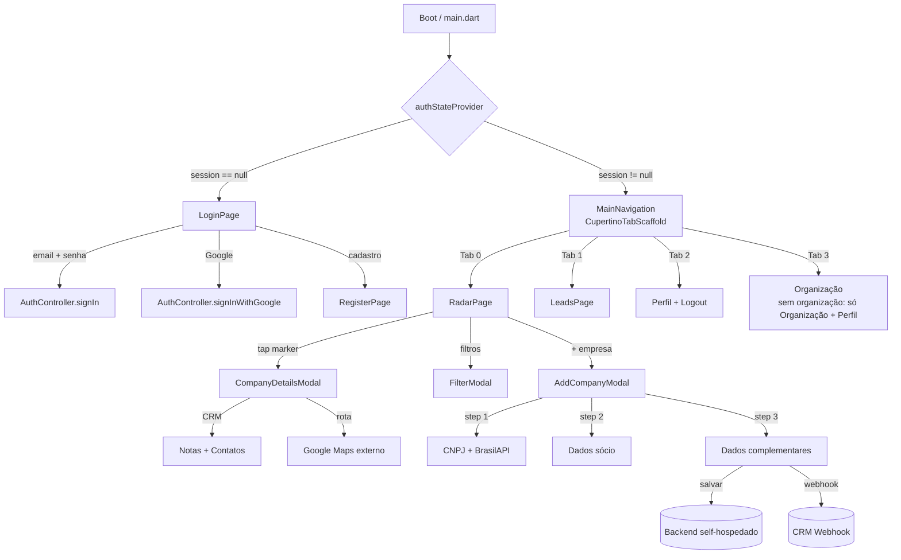

# RUMO App — Guia de Arquitetura

## Stack

| Camada | Tecnologia |
|---|---|
| UI | Flutter + Cupertino Widgets |
| State management | Riverpod 2 (Notifier + FutureProvider) |
| Autenticação | Firebase Auth (+ Crashlytics e Analytics) |
| Backend de dados | Self-hospedado: PostgreSQL + PostGIS exposto via PostgREST, com serviço Python (FastAPI, padrão MVC) auxiliar — atrás de um proxy Caddy |
| Mapa | Google Maps Flutter (com fallback pra OpenStreetMap via `flutter_map` quando não há chave/ela falha — ver [Fallback de mapa](#fallback-de-mapa)) |
| CRM | HubSpot (via `CrmService` — nome agnóstico de fornecedor, ver [Backend self-hospedado](#backend-self-hospedado)) |
| API externa | BrasilAPI (dados de CNPJ, via `CompanyLookupService`) |
| Deploy | Docker + nginx (Flutter Web, local) + Docker Compose (backend self-hospedado)¹; em produção o Caddy da EC2 serve o Flutter Web e o APK (ver [Frontend em produção](#frontend-em-produção-flutter-web--apk)) |

¹ Backend self-hospedado roda local via Docker Compose, ou em produção numa instância EC2
`t3.micro` provisionada via CloudFormation (`infra/aws/backend-stack.yaml`) — ver seção
"Backend self-hospedado" mais abaixo.

---

## Estrutura de diretórios

```
lib/
├── main.dart                          # Inicialização (Firebase) + roteamento por authState
├── firebase_options.dart              # Config do Firebase (gerada via `flutterfire configure`)
│
├── core/
│   ├── app_config.dart                # Variáveis de ambiente (--dart-define-from-file)
│   └── services/
│       ├── api_client.dart            # Cliente HTTP do backend novo: troca idToken do
│       │                              # Firebase por JWT interno e fala com PostgREST/
│       │                              # FastAPI (get/post/upsert/rpc/backend)
│       └── analytics_service.dart     # Provider do FirebaseAnalytics
│
└── features/
    ├── auth/                          # Autenticação e perfil do usuário
    │   ├── login_page.dart
    │   ├── register_page.dart
    │   ├── privacy_policy_page.dart
    │   ├── firebase_auth_messages.dart # Tradução de FirebaseAuthException pra pt-BR
    │   └── providers/
    │       ├── auth_provider.dart     # authStateProvider (Firebase idTokenChanges) +
    │       │                          # AuthController (signIn/signUp/signInWithGoogle)
    │       └── profile_provider.dart  # profileProvider + UserProfile model (via ApiClient)
    │
    ├── map/                           # Feature principal: mapa + radar de empresas
    │   ├── radar_page.dart            # Página do mapa (GoogleMap + bottom list)
    │   ├── models/
    │   │   └── company_model.dart     # Model Company (vem da RPC search_companies)
    │   │   ├── priority_insight.dart  # Lógica pura da explicação: resumo, "vale a viagem?" (compara com os leads mais perto) e diferenças de fatores
    │   │   └── lead_tier.dart         # Faixa do lead (quente/morno/frio) pela nota de prioridade; sem nota, terços pela posição
    │   ├── providers/
    │   │   ├── company_provider.dart  # companiesProvider (FutureProvider)
    │   │   ├── location_provider.dart # locationProvider (GPS com fallback)
    │   │   ├── filter_provider.dart   # MapFiltersNotifier + filterOptionsProvider
    │   │   └── map_backend_provider.dart # useGoogleMapsProvider: Google Maps ou fallback OSM
    │   │   └── lead_tier_provider.dart # leadPriorityProvider/leadTiersProvider: lê a prioridade da carteira inteira (modo compacto) → posição, nota e faixa por company_id
    │   ├── widgets/
    │   │   └── osm_map.dart           # OsmMap (flutter_map) usado quando o Google Maps não está disponível
    │   │   └── lead_pin.dart          # Pino de lead (cor/tamanho por faixa) em widget e PNG + legenda. Cliente = símbolo da Save (assets/icon_save.webp)
    │   ├── services/
    │   │   ├── company_service.dart   # Chamadas RPC via ApiClient (backend self-hospedado)
    │   │   └── tracking_service.dart  # Rastreamento de localização via ApiClient (timer 5 min)
    │   ├── data/
    │   │   └── company_repository.dart # Repository pattern (ICompanyRepository)
    │   └── presentation/
    │       ├── radar_viewmodel.dart   # Estado de UI do bottom sheet
    │       ├── filter_modal.dart      # Modal de filtros avançados
    │       ├── priority_explanation_section.dart # "Por que esta prioridade" nos detalhes: nota, fatores a favor/contra (% dos clientes × base), comparação com os leads mais perto
    │       └── company_details_modal.dart # Detalhes da empresa + CRM
    │
    ├── carteira/                      # Conexão da organização com o CRM (só admin do grupo) + prioridades dos leads
    │   ├── models/crm_models.dart     # CrmProperty/CrmMapping/CrmPreview/CrmConnection/SyncLog
    │   ├── models/priority_models.dart # PriorityResult/PriorityItem/PriorityStrategy (GET /carteira/prioridade)
    │   ├── services/carteira_service.dart # validar/prévia/conectar/sincronizar/desconectar
    │   │                              # (Backend) + leitura de crm_conexoes/sincronizacoes (PostgREST)
    │   ├── providers/carteira_provider.dart # crmConnectionProvider (se reconsulta a cada 5 s
    │   │                              # enquanto a carga inicial roda) + lastSyncProvider +
    │   │                              # priorityProvider (idem enquanto o cálculo não existe)
    │   └── presentation/
    │       ├── priority_sliver.dart   # visão "Prioridades" da aba Leads: lista com nota e motivos sempre visíveis
    │       ├── crm_connection_section.dart # status + ações, dentro de GroupManagementView
    │       └── crm_connection_wizard.dart  # token → campos → prévia → conectar
    │
    ├── groups/presentation/
    │   ├── organization_gate.dart     # espera a lista de organizações; abre o assistente do CRM após criar uma
    │   └── group_onboarding_view.dart # aba Organização sem organização: explica o bloqueio, cria uma (+ CRM) ou entra com o código
    │
    ├── enrichment/                    # Dados públicos nos detalhes da empresa (Receita, compras públicas,
    │   │                              # economia do município, Google) — um bloco por fonte, cada um carrega sozinho
    │   ├── models/enrichment_models.dart # envelope (ok/vazio/indisponivel/desativado) + ReceitaData, ComprasData, …
    │   ├── services/enrichment_service.dart # GET /backend/enriquecimento/{fonte}
    │   ├── providers/enrichment_provider.dart # enrichmentProvider.family((groupId, cnpj, fonte))
    │   └── presentation/enrichment_cards.dart # DetailCard: resumo sempre visível, detalhes ao tocar
    │
    ├── leads/                         # Busca textual de leads + visão "Prioridades" (segmento no topo)
    │   ├── leads_page.dart
    │   └── leads_search_provider.dart # leadsSearchQueryProvider + leadsResultsProvider
    │
    └── company/                       # Cadastro de novas empresas
        ├── add_company_modal.dart     # Multi-step modal (3 passos)
        ├── crm_service.dart           # Integração com o CRM via ApiClient (nome
        │                              # agnóstico de fornecedor — hoje é o HubSpot)
        ├── registration_service.dart  # Consulta de CNPJ (via ApiClient) + geocoding +
        │                              # RPC register_company (carteira da organização ativa)
        └── constants.dart             # Dropdowns: departamentos, setores, regimes, etc.
```

---

## Diagrama de providers

```mermaid
graph TD
    AUTH[authStateProvider<br/>StreamProvider&lt;AuthState&gt;]
    CTRL[authControllerProvider<br/>Provider&lt;AuthController&gt;]
    PROFILE[profileProvider<br/>FutureProvider&lt;UserProfile?&gt;]

    LOC[locationProvider<br/>FutureProvider&lt;Position&gt;]
    FILTERS[mapFiltersProvider<br/>NotifierProvider&lt;MapFilters&gt;]
    FILTER_OPTS[filterOptionsProvider<br/>FutureProvider&lt;Map&gt;]
    CITIES[filteredCitiesProvider<br/>Provider&lt;List&lt;String&gt;&gt;]
    REPO[companyRepositoryProvider<br/>Provider&lt;ICompanyRepository&gt;]
    COMPANIES[companiesProvider<br/>FutureProvider&lt;List&lt;Company&gt;&gt;]

    RADAR_VM[radarViewModelProvider<br/>NotifierProvider&lt;RadarUiState&gt;]
    TRACKING[trackingServiceProvider<br/>Provider&lt;TrackingService&gt;]

    SEARCH_Q[leadsSearchQueryProvider<br/>StateProvider&lt;LeadsSearchQuery&gt;]
    LEADS[leadsResultsProvider<br/>FutureProvider&lt;List&lt;Company&gt;?&gt;]

    HS_NOTES[crmNotesProvider.family<br/>FutureProvider&lt;List&lt;CrmNote&gt;&gt;]
    HS_CONTACTS[crmContactsProvider.family<br/>FutureProvider&lt;List&lt;CrmContact&gt;&gt;]

    LOC --> COMPANIES
    FILTERS --> COMPANIES
    REPO --> COMPANIES
    FILTERS --> FILTER_OPTS
    FILTERS --> CITIES

    COMPANIES --> RADAR_VM

    FILTERS --> LEADS
    REPO --> LEADS
    SEARCH_Q --> LEADS

    PROFILE --> TRACKING

    style AUTH fill:#c8e6c9
    style CTRL fill:#c8e6c9
    style PROFILE fill:#c8e6c9
    style FILTERS fill:#fff9c4
    style RADAR_VM fill:#fff9c4
    style SEARCH_Q fill:#fff9c4
```



> `authStateProvider`/`profileProvider` são hoje alimentados por Firebase Auth + `ApiClient` (PostgREST/FastAPI) — não há mais `SupabaseClient` em nenhum provider.

---

## Fluxo de navegação



---

## Fluxo de dados do mapa

```
GPS (geolocator)
    └─→ locationProvider
            └─→ companiesProvider ←── mapFiltersProvider (raio, segmento, UF, etc.)
                    └─→ CompanyRepository
                            └─→ CompanyService
                                    └─→ ApiClient.rpc('search_companies') ──→ Caddy ──→ PostgREST
                                            └─→ List<Company>
                                                    └─→ RadarPage (GoogleMap markers + bottom list)
```

---

## Fallback de mapa

`useGoogleMapsProvider` (`lib/features/map/providers/map_backend_provider.dart`) decide entre Google Maps e OpenStreetMap (`OsmMap`, em `flutter_map`), em `RadarPage` e `TeamMapPage`:

- **Android/iOS**: OSM quando `GOOGLE_API_KEY` está vazia. O plugin não avisa quando a chave é rejeitada, então só a ausência é detectada.
- **Web**: OSM quando `web/env.js` não tem chave, quando o script do Google não carrega, ou quando o Google chama `gm_authFailure` (chave inválida, cota, domínio não autorizado) — `web/index.html` marca `window.__gmapsFailed` e dispara o evento `gmaps-auth-failure`.

No OSM não existe camada híbrida (o botão de tipo de mapa some) e os marcadores usam os mesmos assets do Google Maps. Os tiles vêm de `tile.openstreetmap.org` (política de uso justo; pra tráfego alto, trocar por um servidor de tiles próprio/pago em `OsmMap`). Nos testes, `FixedMapBackend` (`test/helpers/fake_google_maps.dart`) fixa o backend.

---

## Banco de dados

Self-hospedado — PostgreSQL + PostGIS, exposto via PostgREST (`db/schema/*.sql`).

### Tabelas

| Tabela | Uso |
|---|---|
| `companies` | Catálogo global de dados públicos das empresas (CNPJ, endereço, CNAE, geolocalização). **O acesso é sempre pela carteira de uma organização** — ver [Isolamento entre organizações](#isolamento-entre-organizações) |
| `company_financial_profile` | Dados de crédito/score, 1:1 com `companies` (consulta só no detalhe); mesma regra de visibilidade |
| `company_contacts` | Telefones/e-mails/redes sociais secundários, 1:N; mesma regra de visibilidade |
| `company_crm_sync` | Status de sincronização com o HubSpot; mesma regra de visibilidade |
| `profiles` | Perfis de usuário (`id` = UID do Firebase; nome, departamento, nivel_acesso) |
| `tracking_equipe` | Posição atual de cada usuário (upsert por `user_id`), com `foto_url` (URL da foto da conta Google, mandada pelo app; o Mapa da Equipe mostra a foto ou as iniciais) |
| `tracking_history` | Histórico de localizações (append-only, 1 ponto a cada 5 min por usuário). O admin lê o trajeto de um membro por dia via RPC `list_group_tracking_history` (`016_tracking_history.sql`; só admin do grupo, com `tracking_enabled`, máx. 31 dias) — tela `TrackingHistoryPage`, aberta ao tocar num membro do Mapa da Equipe. **Em produção a `016` precisa ser aplicada à mão** |
| `crm_sync_state` | Marca d'água da sincronização CRM → banco (maior ID de empresa do CRM já processado) |
| `crm_sync_pending` | Empresas do CRM que falharam no ETL e aguardam nova tentativa (com backoff) |
| `carteira_empresas` | Relação de uma organização (`groups`) com cada empresa: `status` cliente/lead/perdido, `origem` crm/manual (`009_carteira.sql`). **É o que dá visibilidade**: empresa sem linha aqui é invisível pra todo usuário |
| `crm_conexoes` | Conexão da organização com o CRM: token cifrado (nunca legível por `web_user`) + mapeamento de campos |
| `sincronizacoes` | Log de cada carga/sincronização do CRM, pra tela de status (o incremental só deixa log se houve novidade ou erro). A carga inicial grava o progresso a cada 5 empresas (`total_estimado`, `total_processadas`; `017_progresso_sincronizacao.sql`, **a aplicar à mão em produção**, junto da limpeza de `nome_fantasia = ''`) |
| `enriquecimento_cache` | Cache das fontes públicas dos detalhes (`018_enriquecimento_cache.sql`): `(fonte, chave)` → `dados` jsonb. Chave = CNPJ (Receita, compras, Google) ou código IBGE do município (comex, IBGE, compartilhado pela cidade). Só `crm_sync` acessa. **Em produção a `018` precisa ser aplicada à mão** |
| `carteira_pendencias` | Fila de retentativas (com backoff) da sincronização por conexão — análoga à `crm_sync_pending`, mas com a conexão na chave (`011_carteira_pendencias.sql`) |

### RPCs (Stored Procedures)

| Função | Parâmetros | Retorno |
|---|---|---|
| `search_companies` | lat, lon, radius_km, query, segment, product, state, city, cnae, is_client, limit, **group_id (obrigatório)** | `List<Company>` — unifica busca por raio, texto e filtros. Só devolve a **carteira da organização** `group_id` (exige ser membro); `cliente` e `status_carteira` vêm dela. Sem `group_id` ou sem ser membro: erro |
| `get_filter_options` | — | `{segments, products, states, cnaes, state_to_cities}` — roda com as permissões de quem chama, então só vê opções das empresas das próprias organizações |
| `register_company` | group_id, data (jsonb) | Cadastro manual: cria a empresa no catálogo (sem sobrescrever uma que já exista) e a põe na carteira da organização como `lead`/`manual`. Exige membro + (admin da organização ou `can_add_company()`). Devolve `{company_id, already_in_portfolio}` — nunca revela se a empresa já existia |
| `portfolio_has_cnpj` | group_id, cnpj | `boolean` — o CNPJ está na carteira DESSA organização? (Não dá pra descobrir se existe em outra) |
| `ensure_profile` | nome, departamento | Cria/retorna o `profile` do usuário autenticado |

O app **não grava mais direto** em `companies` nem nas tabelas satélite: o cadastro de uma empresa (`RegistrationService.saveCompany`) chama `register_company`. O enriquecimento de dados de CNPJ e a integração com o CRM passam pelo backend Python — ver seção abaixo.

### Isolamento entre organizações

A base de clientes é **da organização**: só quem é membro dela vê o que ela possui, e quem não pertence a nenhuma organização não vê nada (sem mapa, busca, leads). É imposto em três camadas, e a que vale é a do servidor:

1. **Banco** (`015_isolamento_organizacao.sql`): `companies`, `company_financial_profile`, `company_contacts` e `company_crm_sync` só são legíveis se `company_in_my_orgs(company_id)` — a empresa está na carteira de uma organização de que o usuário é membro. `web_user` não tem INSERT/UPDATE/DELETE nelas (escrita só pelas RPCs acima e pelo papel `crm_sync` do Backend, que enxerga tudo pra sincronizar).
2. **Backend**: `/company-lookup` exige pertencer a alguma organização; `/crm` exige `group_id`, ser membro, o CNPJ estar na carteira dessa organização e a organização ser a dona do CRM global (`CRM_LEGACY_GROUP_ID`) — as demais ainda não têm notas/contatos (`AccessService`). O webhook de cadastro (`URL_WEBHOOK_CRM`) só recebe cadastros da organização `WEBHOOK_CRM_GROUP_ID` (build do app); vazio = ninguém.
3. **App**: `MainNavigation` só tem as abas Radar e Leads pra quem tem organização; sem ela existem apenas **Organização** (criar uma — e o assistente de conexão do CRM abre em seguida — ou entrar com o código de convite) e **Perfil**. Quem está em mais de uma organização troca a ativa pelo botão "Trocar" da aba Organização. As buscas nem chamam o servidor sem organização ativa.

Testes: `make test-db` (`db/tests/isolation_test.sql`, num Postgres descartável: vários usuários e organizações) + os testes do backend e do app. **Mexeu em RLS, RPC de busca ou nas rotas do Backend? Rode `make test-db`.**

Base antiga sem dono (importada pelo sync de conta única ou cadastrada antes das organizações) fica invisível até ser associada: `db/ops/assign_legacy_companies.sql` (`infra/scripts/isolate_organizations.sh legacy <uuid>`).

---

## Backend self-hospedado

Arquitetura local, orquestrada por `docker-compose.backend.yml` (distinto do `docker-compose.yml`, que só builda o Flutter Web):

| Serviço | Função |
|---|---|
| `db` | PostgreSQL + PostGIS — schema aplicado a partir de `db/schema/*.sql` |
| `postgrest` | Expõe o schema como API REST (tabelas em `/rest/<tabela>`, RPCs em `/rest/rpc/<fn>`) |
| `backend` | Serviço Python (FastAPI) — troca o idToken do Firebase por um JWT interno, e expõe `/company-lookup` e `/crm` |
| `caddy` | Reverse proxy único, ponto de entrada em `localhost:8080` — roteia `/rest/*` e `/backend/*` |

**Autenticação**: o app troca o `idToken` do Firebase por um JWT interno (`POST /backend/auth/exchange`), que o PostgREST usa pra aplicar RLS via `SET ROLE` (`auth_uid()` em `db/schema/003_roles_rls.sql`).

**Integrações externas** — nomeadas de forma agnóstica de fornecedor (`CompanyLookupService`, `CrmService`), pra trocar de provedor sem reescrever a estrutura:
- `/company-lookup` (`backend/app/services/company_lookup_service.py`) — hoje consulta a [BrasilAPI](https://brasilapi.com.br/) (pública, gratuita, sem token). Devolve o mesmo shape de chaves que o provedor antigo produzia, pra não exigir mudança nenhuma em `RegistrationService.saveCompany`/`sendToWebhook`.
- `/crm` (`backend/app/services/crm_service.py`) — hoje integra com o HubSpot (API v3/v4), localizando a Company pelo CNPJ via uma propriedade customizada cujo nome interno é configurável (`CRM_CNPJ_PROPERTY_NAME`, porque é criada manualmente na conta do CRM). 4 ações: `getNotesWithOwners`, `getContacts`, `addContact`, `addNote`.

**Sincronização CRM → banco** (`backend/app/services/crm_sync_service.py`) — a fonte das empresas é o CRM: a cada `CRM_SYNC_INTERVAL_SECONDS` (600) um loop `asyncio` iniciado no `lifespan` do FastAPI traz pro banco as empresas novas do CRM (com CNPJ preenchido), já enriquecidas e geocodificadas. **Nunca lista o CRM nem varre `companies`**:
- Checagem barata: 1 consulta à marca d'água (`crm_sync_state`) + 1 chamada ao Search do HubSpot filtrada por `hs_object_id > marca d'água` (ordenada, `limit` 100; IDs do HubSpot são crescentes) + 1 consulta à fila `crm_sync_pending` (tabela minúscula). Sem novidade, nada é escrito.
- O Search demora a indexar empresas novas; por isso a consulta também inclui (OR) as criadas nos últimos `CRM_SYNC_OVERLAP_MINUTES` (30), e o lote devolvido (≤100) é deduplicado por CNPJ com um único SELECT indexado.
- ETL por empresa nova: `CompanyLookupService` (BrasilAPI) → `GeocodingService` (Google Geocoding, chave de servidor `GEOCODING_API_KEY`) → `build_company_row`, o MESMO mapeamento de `RegistrationService.saveCompany` → INSERT com `ON CONFLICT DO NOTHING` (nunca sobrescreve o que o app cadastrou) + vínculo em `company_crm_sync`. Empresa que o app já cadastrou só ganha o vínculo.
- Falhas (CNPJ não achado, sem coordenada, rede) vão pra `crm_sync_pending` com backoff e máximo de 5 tentativas; a marca d'água avança além delas.
- Acesso ao banco via PostgREST (`PostgrestClient`) com token interno de papel `crm_sync` (privilégio mínimo, `db/schema/008_crm_sync.sql`) — o Backend não tem driver de Postgres.
- **Desligada por padrão** (`CRM_SYNC_ENABLED=false`). Em produção, ligue com `infra/scripts/enable_crm_sync.sh` (`INSTANCE_ID=<id>`), nesta ordem: `migrate` (aplica a `008` — o schema só roda sozinho em banco vazio) → `config` (grava `GEOCODING_API_KEY` no Secrets Manager e atualiza o `infra/.env` da EC2) → `backfill` (importa o histórico do CRM uma vez; paginado por ID, idempotente) → `enable` (liga o job). `status` mostra logs, marca d'água, pendências e contagens. `DRY_RUN=1` só mostra o que seria feito. Sem backfill, a primeira execução do job só parte do maior ID atual do CRM, sem importar nada.

**Sincronização por organização** (`backend/app/services/carteira_sync_service.py`) — substitui, por conexão, o sync de conta única acima (que continua no código, desligado). Cada organização conecta o próprio CRM com um token (`crm_conexoes`, cifrado com Fernet por `CRM_TOKEN_ENCRYPTION_KEY`); a cada `CRM_SYNC_INTERVAL_SECONDS` o job percorre as conexões `ativa`, em sequência:
- Lê do CRM só o que **mudou** desde a marca d'água `crm_conexoes.ultima_modificacao_crm` (por data de modificação, com a mesma janela de sobreposição), então pega mudança de status e não só empresa nova. Marca d'água gravada por página, então uma carga que cai no meio retoma dali.
- `CrmConnector` (`crm_connector.py`) é a interface por CRM (`validate`, `list_properties`, `fetch_changes`); `HubSpotConnector` é o primeiro. Só dados de **empresa** são lidos (nunca contatos/notas/negócios). `CrmMapping` (`crm_conexoes.mapeamento`) diz qual propriedade é o CNPJ e que valores do estágio significam cliente/perdido (o resto é lead).
- `companies` é global: CNPJ já trazido por outra organização não é reconsultado na BrasilAPI/Google. O status vai pra `carteira_empresas`. Falhas por empresa vão pra `carteira_pendencias` (máx. 5 tentativas).
- Sem novidade, escreve só `ultima_sincronizacao` na conexão. Ligar com `CRM_CONNECTIONS_SYNC_ENABLED=true` (exige `CRM_TOKEN_ENCRYPTION_KEY` e `GEOCODING_API_KEY`). **Perder/trocar a chave de cifra obriga todas as organizações a reconectar.** Em produção, a chave entra no Secrets Manager junto das demais variáveis de `infra/.env`.

**Conectar o CRM** (`backend/app/services/carteira_connection_service.py`, rotas `/backend/carteira/*`) — identidade = o token interno que o app já usa (`Authorization: Bearer`), e só **admin da organização** (conferido em `group_members`, `012_crm_sync_group_members.sql`) conecta, sincroniza ou desconecta:

| Rota | O que faz |
|---|---|
| `POST /carteira/conexao/validar` | Confere o token no CRM e lista as propriedades de empresa (pra o usuário mapear CNPJ e estágio). Sem estado |
| `POST /carteira/conexao/previa` | Conta quantas empresas seriam importadas, por status (até 5.000; `truncado` se houver mais). Sem estado |
| `PUT /carteira/conexao` | Grava a conexão (token cifrado) e dispara a carga inicial em segundo plano (202). Reconectar zera a marca d'água e relê tudo |
| `POST /carteira/conexao/sincronizar?group_id=` | "Sincronizar agora" (202; 409 se já houver uma em andamento) |
| `DELETE /carteira/conexao?group_id=&apagar_carteira=` | Desconecta; com `apagar_carteira=true` remove também as linhas de origem `crm` |

O token só chega ao banco no `PUT`, cifrado; validar e prévia não gravam nada. O status da conexão o app lê direto pelo PostgREST (`crm_conexoes`, sem a coluna do token, e `sincronizacoes`) — **sempre com `select` explícito em `crm_conexoes`**: o GRANT por coluna faz o PostgREST negar `select=*`. A tela é `lib/features/carteira/`; `ApiClient.backendRequest` faz PUT/DELETE/query nas rotas do Backend e `ApiException` lê tanto `message` (PostgREST) quanto `detail` (FastAPI). Sem `CRM_TOKEN_ENCRYPTION_KEY` as rotas respondem 503. O handler de 422 omite o campo `input` do erro: ele traria o corpo inteiro, com o token.

**Prioridade dos leads** (`priority_service.py`, `priority_score.py`, `logistic_score.py`, `cold_start_priority.py`) — o resultado é **calculado ao fim de cada sincronização que mudou a carteira** (ou quando ainda não há resultado) e **gravado**: `prioridade_modelos` (estratégia, tamanhos, modelo em jsonb) e `carteira_prioridade` (um lead por linha, já ordenado, com nota e motivos; `014_carteira_prioridade.sql`). `GET /carteira/prioridade?group_id=&limit=` (qualquer membro) só LÊ essas tabelas: nunca varre `companies` nem recalcula; `compacto=true` devolve só id/posição/nota (até 5.000 — o mapa usa pra colorir a carteira inteira). `GET /carteira/prioridade/empresa?group_id=&company_id=` explica UM lead: reaplica o modelo guardado (`prioridade_modelos.modelo`) à empresa e devolve todos os fatores (a favor, neutros e contra, com % dos clientes e da base) e as características sem dado. Só o papel `crm_sync` tem acesso a elas.
- Estratégia pelo nº de clientes (`choose_strategy`): `< MIN_CLIENTS` (10) → **interação** (mais interações no CRM; empate pelo registro mais antigo; usa `crm_criado_em`/`num_interacoes` vindos de propriedades da empresa no HubSpot, `013_carteira_interacao.sql`); `>=` → **perfil** (baseline lookalike por razão de chances, naive Bayes com a priori na base). A regressão logística (`logistic_score.py`, numpy + L-BFGS próprio, sem scipy) existe e é avaliável, mas **ainda não está no seletor**: o limiar de troca deve sair de `model_comparison.learning_curve` com a carteira real.
- O perfil lê a base `companies` (até 50.000 linhas) **a cada recálculo** (por sincronização, não por chamada). Desconectar com `apagar_carteira` apaga o resultado da organização.

**Enriquecimento dos detalhes** (`backend/app/services/enrichment/`, rota `GET /enriquecimento/{fonte}?group_id=&cnpj=`) — exige ser membro e o CNPJ estar na carteira da organização (`AccessService`). Uma fonte por chamada, pro app carregar cada bloco no seu tempo; fonte fora do ar não é erro HTTP (volta `status: indisponivel`, ou o último dado guardado com `desatualizado: true`). Fontes, todas sem chave exceto o Google:
- `receita` — BrasilAPI, com o Minha Receita (minhareceita.org) de reserva: situação, abertura, porte, capital, Simples/MEI, histórico de regime tributário, CNAEs e sócios. Cache de 7 dias.
- `compras` — Compras.gov.br (dados abertos): SICAF e itens ganhos em licitações do PNCP (Lei 14.133), últimos 12 meses e os 12 anteriores (a API aceita no máximo 365 dias); detalhe das 5 maiores no PNCP (órgão, objeto, modalidade). Cache de 1 dia.
- `comex` — Comex Stat (MDIC): exportação/importação do **município** no último ano fechado (produtos SH4 e países). Não há comércio exterior por CNPJ em API pública. Cache de 30 dias.
- `municipio` — IBGE: população, PIB e PIB per capita. Cache de 30 dias.
- `google` — Google Places (API New) com a `GEOCODING_API_KEY` (precisa da Places API ativada): foto de capa (com crédito do autor), nota, avaliações, telefone, site, horários. **Sob demanda e cobrado por consulta**: o app só chama quando a pessoa toca em "Ver no Google". **Termos do Google Maps: só o `place_id` fica guardado** (`enriquecimento_cache`, fonte `google_place_id`, 12 meses); nota, horários e foto são buscados a cada pedido (Place Details pelo id; busca por texto só na 1ª vez ou se o id deixar de existir). "Não encontrado" fica 7 dias, pra não repetir busca paga. A foto vem como link temporário do googleusercontent (sem a chave). `ENRICHMENT_GOOGLE_PLACES_ENABLED=false` desliga. "Aberto agora" é calculado no horário de Brasília.

Migração nova com tabela/coluna? Termine com `NOTIFY pgrst, 'reload schema';` — senão o PostgREST não enxerga a mudança até reiniciar.

Testes do backend: `backend/tests/` (pytest + respx, mockando as chamadas HTTP externas) — `cd backend && pip install -r requirements-dev.txt && pytest`.

Variáveis do backend ficam em `infra/.env` (copiar de `infra/.env.example`, gitignored) — distintas do `.env` do app Flutter. `CRM_CNPJ_PROPERTY_NAME` deve ser ajustada depois que a propriedade de CNPJ for criada no HubSpot.

---

## Variáveis de ambiente

Definidas em `.env` (raiz, não versionado) e injetadas no build via `--dart-define-from-file=.env`.
Acessadas em código via `AppConfig` (`lib/core/app_config.dart`).

| Variável | Uso |
|---|---|
| `API_BASE_URL` | URL base do backend self-hospedado (Caddy) — default `http://localhost:8080` |
| `SERVER_WEB_CLIENT_ID` | OAuth Google (Web / servidor) |
| `CLIENT_ID` | OAuth Google (iOS) |
| `GOOGLE_API_KEY` | Google Maps + Geocoding (no iOS nativo, precisa ser duplicada em `ios/Flutter/Secrets.xcconfig` — ver "Executando o projeto localmente") |
| `URL_WEBHOOK_CRM` | Webhook de CRM chamado após cadastro de empresa |

> O backend self-hospedado tem seu próprio arquivo de variáveis (`infra/.env`, a partir de `infra/.env.example`) — não listado aqui, que é só do app Flutter.

---

## Deploy (Docker)

### App (Flutter Web) — Docker local

> Este caminho (nginx) é só pra rodar localmente. Em produção o frontend é servido pelo
> Caddy da EC2 — ver [Frontend em produção](#frontend-em-produção-flutter-web--apk).

```
Dockerfile (multi-stage)
  Stage 1 — Build
    ubuntu:22.04
    flutter build web --release --dart-define-from-file=.env
    output: build/web/

  Stage 2 — Serve
    nginx:alpine
    COPY build/web/ → /usr/share/nginx/html
    EXPOSE 80
```

```bash
# Build e subir localmente
docker-compose up --build
```

### Backend self-hospedado

```bash
cp infra/.env.example infra/.env   # preencher segredos antes de tudo
docker-compose -f docker-compose.backend.yml up -d
```

Deploy em produção (AWS — 1 instância EC2 `t3.micro` + CloudFormation, acesso via SSM
Session Manager, sem SSH): template em `infra/aws/backend-stack.yaml`.

```bash
# Segredos (uma vez, antes do primeiro deploy)
aws secretsmanager create-secret --name rumo-app/backend-env --secret-string file://infra/.env.json
aws secretsmanager create-secret --name rumo-app/firebase-service-account --secret-string file://infra/firebase-service-account.json

# Provisiona a infra (EC2 + EIP + volume de dados dedicado + Security Group)
aws cloudformation deploy --template-file infra/aws/backend-stack.yaml \
  --stack-name rumo-app-backend --capabilities CAPABILITY_NAMED_IAM \
  --parameter-overrides VpcId=<vpc-id> SubnetId=<subnet-id> AvailabilityZone=<az>

# Redeploy manual (atualização de código, via SSM — sem SSH)
make deploy INSTANCE_ID=<instance-id>
```

O UserData clona a branch `main` do repositório (público) no boot (parâmetro `RepoBranch`), busca os segredos no
Secrets Manager e sobe a stack com `docker-compose.backend.yml` + `docker-compose.prod.yml`
(override que publica só 80/443 via Caddy — as portas internas de banco/PostgREST/backend
não ficam expostas). TLS automático via Let's Encrypt, usando um subdomínio DuckDNS
gratuito (`rumo-app.duckdns.org` por padrão — parâmetro `DomainName` do template).

> **Região**: a stack `rumo-app-backend` roda em **us-east-1**, que pode não ser a região
> padrão do seu AWS CLI. O `Makefile` já passa `--region $(AWS_REGION)` (padrão `us-east-1`);
> em comandos `aws` manuais, passe `--region us-east-1`.
>
> **A EC2 acompanha a branch `main`**: o `make deploy` faz `git fetch` + `git checkout -B main`
> lá (`BRANCH=<outra>` troca a branch; serve também pra migrar uma instância que ainda esteja
> noutra). Mudanças de infra/compose só chegam à produção depois de mergeadas na `main`.
> O parâmetro `RepoBranch` só vale no boot de uma instância nova: trocá-lo numa stack existente
> não move a instância já criada (e mexer no UserData derruba a EC2) — use o `make deploy`.
>
> **Migrações**: `db/schema/*.sql` só são aplicadas automaticamente em banco **vazio**
> (`docker-entrypoint-initdb.d`). Um arquivo novo (ex.: `008_crm_sync.sql`) precisa ser
> aplicado à mão no banco de produção, via SSM, antes de ligar o recurso que depende dele.

### Frontend em produção (Flutter Web + APK)

O Caddy (`infra/Caddyfile.production`) serve, no **mesmo domínio** da API:

| Caminho | Conteúdo |
|---|---|
| `/` | Flutter Web (SPA — rota desconhecida cai no `index.html`) |
| `/download/rumo.apk` | APK Android assinado (link público) |
| `/rest/*`, `/backend/*` | PostgREST e backend (como antes) |

Como o site e a API têm a mesma origem, **não há CORS em produção** (CORS só aparece ao testar de
`localhost` contra a AWS — use um Chrome com `--disable-web-security`).

Os arquivos ficam no volume EBS (`/mnt/rumo-data/web` e `/mnt/rumo-data/downloads`, montados
somente-leitura no Caddy por `docker-compose.prod.yml`) e chegam de um bucket S3 privado, criado
pela stack **separada** `infra/aws/artifacts-stack.yaml` (não mexe na instância). O build é feito
**localmente** — a `t3.micro` não aguenta compilar Flutter.

```bash
# Uma vez: bucket privado + política de leitura na role da EC2 (us-east-1)
aws cloudformation deploy --region us-east-1 \
  --template-file infra/aws/artifacts-stack.yaml \
  --stack-name rumo-app-artifacts --capabilities CAPABILITY_NAMED_IAM

# A cada publicação (build local -> S3 -> sync na EC2 via SSM)
make deploy-web INSTANCE_ID=<instance-id> ARTIFACTS_BUCKET=<bucket>   # Flutter Web
make deploy-apk INSTANCE_ID=<instance-id> ARTIFACTS_BUCKET=<bucket>   # APK em /download/rumo.apk
```

Pré-requisitos do build (todos fora do git): `.env`; `web/env.js` (chave do Maps no Web);
`android/key.properties` + keystore (assinatura do APK); `android/secrets.properties`
(`GOOGLE_MAPS_API_KEY`, ver `android/secrets.properties.example` — sem ele o mapa do APK fica
em branco). O script é `infra/scripts/deploy_frontend.sh`.

Ordem pra subir uma versão: **merge na `main`** (PR `dev` → `main`) → `make deploy` (atualiza o Caddy/backend na EC2) →
`make deploy-web` e/ou `make deploy-apk`.

**Carteira por organização em produção** (`infra/scripts/enable_carteira_sync.sh`, `INSTANCE_ID=<id>`;
`DRY_RUN=1` só mostra o que seria feito). Ordem, porque o app novo chama o schema novo:

1. `migrate` — aplica `db/schema/008`–`014` (idempotentes; a 008 cria o papel `crm_sync` que as demais usam).
2. `make deploy` — reconstrói a imagem do Backend (agora com numpy) na `main`.
3. `config` — garante no Secrets Manager `CRM_TOKEN_ENCRYPTION_KEY` (gerada **uma vez**, nunca
   sobrescrita: perdê-la obriga todas as organizações a reconectar o CRM — faça backup do segredo) e
   `GEOCODING_API_KEY` (chave de servidor; informe via variável de ambiente só se o segredo ainda não a tem).
   O job continua desligado.
4. `enable` — liga `CRM_CONNECTIONS_SYNC_ENABLED` (confere antes que a imagem tem numpy/cryptography).
5. `make deploy-web` / `make deploy-apk` — publica o app com a aba de prioridades.

`status` mostra conexões, carteira e prioridade (só leitura).

**Isolamento entre organizações em produção** (`infra/scripts/isolate_organizations.sh`, `INSTANCE_ID=<id>`; `DRY_RUN=1` só mostra os comandos). Atenção: **o app antigo deixa de funcionar** assim que a `015` entra (a busca passa a exigir organização), então publique o app novo logo em seguida. Ordem:

1. `make deploy` — backend novo (`/crm` e `/company-lookup` passam a exigir organização).
2. `migrate` — leva a EC2 pra `main` e aplica a `015`.
3. `legacy <uuid-da-organização>` — associa a base atual (sem dono) a essa organização; antes, `COUNT_ONLY=1` mostra quantas empresas são. **Sem este passo, as empresas atuais ficam invisíveis pra todos** (nada é apagado).
4. `config <uuid-da-organização>` — grava `CRM_LEGACY_GROUP_ID` (a organização dona do CRM global) e **desliga o sync antigo de conta única** (`CRM_SYNC_ENABLED=false`, que importaria empresas sem organização).
5. `verify` — só leitura: simula um usuário sem organização e confere que ele vê 0 empresas e que a busca é recusada.
6. `make deploy-web` / `make deploy-apk` — se a organização do passo 3 deve continuar enviando cadastros ao webhook de CRM, ponha `WEBHOOK_CRM_GROUP_ID=<uuid>` no `.env` do build (sem isso o webhook fica desligado).

Configuração manual fora do código: Firebase > Authentication > *Authorized domains* precisa
incluir `rumo-app.duckdns.org` (senão o login com Google no site falha); pro login com Google no
APK, o SHA-1 do keystore precisa estar cadastrado no app Android do Firebase (e o
`google-services.json` baixado de novo); a chave do Maps precisa aceitar o domínio (Web) e o
pacote + SHA-1 (Android).

---

## Padrões adotados

### State management (Riverpod 2)

| Tipo | Quando usar |
|---|---|
| `StreamProvider` | Streams contínuos (ex: auth state) |
| `FutureProvider` | Async one-shot (ex: buscar empresas, perfil) |
| `NotifierProvider` | Estado mutável com ações (ex: filtros, UI state) |
| `StateProvider` | Estado simples de UI (ex: query de busca) |
| `Provider` | Serviços/repositórios sem estado (ex: AuthController, CompanyRepository) |
| `.family` | Providers parametrizados (ex: notas por CNPJ) |

### Repository pattern (feature/map)

```
RadarPage
  └─→ companiesProvider (FutureProvider)
        └─→ ICompanyRepository (abstração)
              └─→ CompanyRepository (implementação)
                    └─→ CompanyService (ApiClient — PostgREST/FastAPI via Caddy)
```

### Permissões de cadastro

Só cadastra quem é membro da organização ativa **e** é admin dela ou tem `UserProfile.canAddCompany` (`register_company` confere no banco). `canAddCompany` é `true` se:
- `departamento` ∈ `{Pré-vendas, Gestão, Administração Interna}`
- OU `nivelAcesso == 'admin'`

---

## Executando o projeto localmente

Pré-requisito comum: `.env` do Flutter configurado (ver "Variáveis de ambiente") **e** o backend self-hospedado no ar:

```bash
cp infra/.env.example infra/.env
make db-up            # sobe db + postgrest + backend + caddy
make data             # opcional — popula empresas fictícias pra testar o radar
```

### Via web

```bash
flutter run -d chrome --dart-define-from-file=.env
```

### Via app — Android

```bash
flutter devices
flutter run --dart-define-from-file=.env   # ou -d <id> pra escolher o dispositivo
```

Emulador do Android Studio ou dispositivo físico com depuração USB habilitada. O app pede permissões de localização em runtime (`ACCESS_FINE_LOCATION`, `ACCESS_COARSE_LOCATION`, `ACCESS_BACKGROUND_LOCATION`).

### Via app — iOS

**Exige um Mac com Xcode instalado.** O simulador (`open -a Simulator`) serve pra desenvolver, mas validar em **iPhone físico** é necessário — permissões de localização em background se comportam diferente no simulador.

Passo extra específico do iOS (o código nativo não lê `--dart-define`):
1. Copiar `ios/Flutter/Secrets.xcconfig.example` → `ios/Flutter/Secrets.xcconfig`.
2. Preencher `GOOGLE_MAPS_API_KEY` com o mesmo valor do `GOOGLE_API_KEY` do `.env`.
3. `cd ios && pod install` antes do primeiro build.

```bash
flutter run --dart-define-from-file=.env
```

### Gerando o APK Android

```bash
flutter build apk --debug --dart-define-from-file=.env
flutter build apk --release --dart-define-from-file=.env
```

Build de release exige `android/key.properties` (não versionado) apontando para um keystore (`storePassword`, `keyPassword`, `keyAlias`, `storeFile`) — sem esse arquivo não é possível gerar um APK de release assinado. Saída em `build/app/outputs/flutter-apk/`.

---

## Comandos úteis

```bash
# Desenvolvimento web com variáveis de ambiente
flutter run -d chrome --dart-define-from-file=.env

# Desenvolvimento mobile (Android/iOS, dispositivo ou emulador já selecionado)
flutter run --dart-define-from-file=.env

# Build web
flutter build web --release --dart-define-from-file=.env

# Build APK Android (release, assinado — requer android/key.properties)
flutter build apk --release --dart-define-from-file=.env

# Análise estática
flutter analyze

# Build Docker (app)
docker build -t rumo-app .
docker run -p 80:80 rumo-app

# Backend self-hospedado (Makefile da raiz)
make db-up                 # sobe db + postgrest + backend + caddy
make db-down                # derruba os containers, mantém os dados
make db-reset                # apaga os volumes e reaplica o schema do zero
make migrate                 # reaplica db/schema/*.sql manualmente
make test-db                 # testa o isolamento entre organizações num Postgres descartável
make token UID=algum-uid      # gera um JWT de teste
make data [COUNT=40]           # popula empresas fictícias pra testar o radar
```
