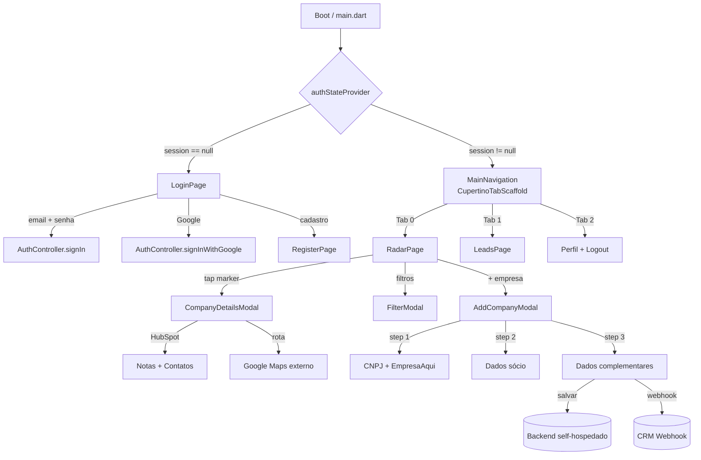

# RUMO App — Guia de Arquitetura

## Stack

| Camada | Tecnologia |
|---|---|
| UI | Flutter + Cupertino Widgets |
| State management | Riverpod 2 (Notifier + FutureProvider) |
| Autenticação | Firebase Auth (+ Crashlytics e Analytics) |
| Backend de dados | Self-hospedado: PostgreSQL + PostGIS exposto via PostgREST, com serviço Python (FastAPI, padrão MVC) auxiliar — atrás de um proxy Caddy |
| Mapa | Google Maps Flutter |
| CRM | HubSpot API v3¹ |
| API externa | EmpresaAqui (dados de CNPJ)¹ |
| Deploy | Docker + nginx (Flutter Web) + Docker Compose (backend self-hospedado)² |

¹ Integração ainda não implementada no backend novo — ver [Backend self-hospedado](#backend-self-hospedado). O roadmap (`plano_geral.md`) prevê substituir a EmpresaAqui por BrasilAPI (ou equivalente); ainda não começou.
² Deploy em produção via AWS (EC2 + CloudFormation) está no roadmap (`plano_geral.md`), ainda não implementado — hoje o backend só roda local/self-hospedado via Docker Compose.

---

## Estrutura de diretórios

```
lib/
├── main.dart                          # Inicialização (Firebase) + roteamento por authState
├── firebase_options.dart              # Config do Firebase (gerada via `flutterfire configure`)
│
├── core/
│   ├── app_config.dart                # Variáveis de ambiente (--dart-define-from-file)
│   └── services/
│       ├── api_client.dart            # Cliente HTTP do backend novo: troca idToken do
│       │                              # Firebase por JWT interno e fala com PostgREST/
│       │                              # FastAPI (get/post/upsert/rpc/backend)
│       └── analytics_service.dart     # Provider do FirebaseAnalytics
│
└── features/
    ├── auth/                          # Autenticação e perfil do usuário
    │   ├── login_page.dart
    │   ├── register_page.dart
    │   ├── privacy_policy_page.dart
    │   ├── firebase_auth_messages.dart # Tradução de FirebaseAuthException pra pt-BR
    │   └── providers/
    │       ├── auth_provider.dart     # authStateProvider (Firebase idTokenChanges) +
    │       │                          # AuthController (signIn/signUp/signInWithGoogle)
    │       └── profile_provider.dart  # profileProvider + UserProfile model (via ApiClient)
    │
    ├── map/                           # Feature principal: mapa + radar de empresas
    │   ├── radar_page.dart            # Página do mapa (GoogleMap + bottom list)
    │   ├── models/
    │   │   └── company_model.dart     # Model Company (vem da RPC search_companies)
    │   ├── providers/
    │   │   ├── company_provider.dart  # companiesProvider (FutureProvider)
    │   │   ├── location_provider.dart # locationProvider (GPS com fallback)
    │   │   └── filter_provider.dart   # MapFiltersNotifier + filterOptionsProvider
    │   ├── services/
    │   │   ├── company_service.dart   # Chamadas RPC via ApiClient (backend self-hospedado)
    │   │   └── tracking_service.dart  # Rastreamento de localização via ApiClient (timer 5 min)
    │   ├── data/
    │   │   └── company_repository.dart # Repository pattern (ICompanyRepository)
    │   └── presentation/
    │       ├── radar_viewmodel.dart   # Estado de UI do bottom sheet
    │       ├── filter_modal.dart      # Modal de filtros avançados
    │       └── company_details_modal.dart # Detalhes da empresa + HubSpot
    │
    ├── leads/                         # Feature de busca textual de leads
    │   ├── leads_page.dart
    │   └── leads_search_provider.dart # leadsSearchQueryProvider + leadsResultsProvider
    │
    └── company/                       # Cadastro de novas empresas
        ├── add_company_modal.dart     # Multi-step modal (3 passos)
        ├── hubspot_service.dart       # Integração HubSpot via ApiClient — hoje devolve
        │                              # 501 (não implementado no backend, ver nota abaixo)
        ├── registration_service.dart  # EmpresaAqui (via ApiClient, 501 por ora) +
        │                              # geocoding + upsert em `companies` via ApiClient
        └── constants.dart             # Dropdowns: departamentos, setores, regimes, etc.
```

---

## Diagrama de providers

```mermaid
graph TD
    AUTH[authStateProvider<br/>StreamProvider&lt;AuthState&gt;]
    CTRL[authControllerProvider<br/>Provider&lt;AuthController&gt;]
    PROFILE[profileProvider<br/>FutureProvider&lt;UserProfile?&gt;]

    LOC[locationProvider<br/>FutureProvider&lt;Position&gt;]
    FILTERS[mapFiltersProvider<br/>NotifierProvider&lt;MapFilters&gt;]
    FILTER_OPTS[filterOptionsProvider<br/>FutureProvider&lt;Map&gt;]
    CITIES[filteredCitiesProvider<br/>Provider&lt;List&lt;String&gt;&gt;]
    REPO[companyRepositoryProvider<br/>Provider&lt;ICompanyRepository&gt;]
    COMPANIES[companiesProvider<br/>FutureProvider&lt;List&lt;Company&gt;&gt;]

    RADAR_VM[radarViewModelProvider<br/>NotifierProvider&lt;RadarUiState&gt;]
    TRACKING[trackingServiceProvider<br/>Provider&lt;TrackingService&gt;]

    SEARCH_Q[leadsSearchQueryProvider<br/>StateProvider&lt;LeadsSearchQuery&gt;]
    LEADS[leadsResultsProvider<br/>FutureProvider&lt;List&lt;Company&gt;?&gt;]

    HS_NOTES[hubspotNotesProvider.family<br/>FutureProvider&lt;List&lt;HubSpotNote&gt;&gt;]
    HS_CONTACTS[hubspotContactsProvider.family<br/>FutureProvider&lt;List&lt;HubSpotContact&gt;&gt;]

    LOC --> COMPANIES
    FILTERS --> COMPANIES
    REPO --> COMPANIES
    FILTERS --> FILTER_OPTS
    FILTERS --> CITIES

    COMPANIES --> RADAR_VM

    FILTERS --> LEADS
    REPO --> LEADS
    SEARCH_Q --> LEADS

    PROFILE --> TRACKING

    style AUTH fill:#c8e6c9
    style CTRL fill:#c8e6c9
    style PROFILE fill:#c8e6c9
    style FILTERS fill:#fff9c4
    style RADAR_VM fill:#fff9c4
    style SEARCH_Q fill:#fff9c4
```



> `authStateProvider`/`profileProvider` são hoje alimentados por Firebase Auth + `ApiClient` (PostgREST/FastAPI) — não há mais `SupabaseClient` em nenhum provider.

---

## Fluxo de navegação



---

## Fluxo de dados do mapa

```
GPS (geolocator)
    └─→ locationProvider
            └─→ companiesProvider ←── mapFiltersProvider (raio, segmento, UF, etc.)
                    └─→ CompanyRepository
                            └─→ CompanyService
                                    └─→ ApiClient.rpc('search_companies') ──→ Caddy ──→ PostgREST
                                            └─→ List<Company>
                                                    └─→ RadarPage (GoogleMap markers + bottom list)
```

---

## Banco de dados

Self-hospedado — PostgreSQL + PostGIS, exposto via PostgREST (`db/schema/*.sql`).

### Tabelas

| Tabela | Uso |
|---|---|
| `companies` | Identidade + geolocalização das empresas (busca/radar) |
| `company_financial_profile` | Dados de crédito/score, 1:1 com `companies` (consulta só no detalhe) |
| `company_contacts` | Telefones/e-mails/redes sociais secundários, 1:N |
| `company_crm_sync` | Status de sincronização com o HubSpot |
| `profiles` | Perfis de usuário (`id` = UID do Firebase; nome, departamento, nivel_acesso) |
| `tracking_equipe` | Posição atual de cada usuário (upsert por `user_id`) |
| `tracking_history` | Histórico de localizações (append-only) |

### RPCs (Stored Procedures)

| Função | Parâmetros | Retorno |
|---|---|---|
| `search_companies` | lat, lon, radius_km, query, segment, product, state, city, cnae, is_client, limit | `List<Company>` — unifica busca por raio, texto e filtros num único endpoint |
| `get_filter_options` | — | `{segments, products, states, cnaes, state_to_cities}` |
| `ensure_profile` | nome, departamento | Cria/retorna o `profile` do usuário autenticado |

O cadastro de uma nova empresa (`RegistrationService.saveCompany`) grava direto em `companies` via `ApiClient.upsert` (permitido por RLS para quem pode cadastrar — ver `can_add_company()`). O enriquecimento de dados de CNPJ (EmpresaAqui) e a integração com o HubSpot passam pelo backend Python — ver seção abaixo.

---

## Backend self-hospedado

Arquitetura local, orquestrada por `docker-compose.backend.yml` (distinto do `docker-compose.yml`, que só builda o Flutter Web):

| Serviço | Função |
|---|---|
| `db` | PostgreSQL + PostGIS — schema aplicado a partir de `db/schema/*.sql` |
| `postgrest` | Expõe o schema como API REST (tabelas em `/rest/<tabela>`, RPCs em `/rest/rpc/<fn>`) |
| `backend` | Serviço Python (FastAPI) — troca o idToken do Firebase por um JWT interno, e expõe `/empresa-aqui` e `/hubspot` |
| `caddy` | Reverse proxy único, ponto de entrada em `localhost:8080` — roteia `/rest/*` e `/backend/*` |

**Autenticação**: o app troca o `idToken` do Firebase por um JWT interno (`POST /backend/auth/exchange`), que o PostgREST usa pra aplicar RLS via `SET ROLE` (`auth_uid()` em `db/schema/003_roles_rls.sql`).

**Status de implementação**:
- ✅ Autenticação, perfil, busca/radar de empresas, tracking de localização e cadastro de empresa (`companies`) funcionam de ponta a ponta contra esse backend.
- ⚠️ `/empresa-aqui` e `/hubspot` (`backend/app/services/empresa_aqui_service.py`, `hubspot_service.py`) são stubs intencionais que sempre devolvem **501 Not Implemented** — a lógica real das antigas Edge Functions precisa ser extraída e reimplementada ali antes de funcionar (comentário no próprio código: *"BLOQUEIO #2 do plano"*). `RegistrationService.fetchEmpresaAqui` e `HubSpotService` já chamam esses endpoints; vão continuar devolvendo erro até esse trabalho ser feito.

Variáveis do backend ficam em `infra/.env` (copiar de `infra/.env.example`, gitignored) — distintas do `.env` do app Flutter.

---

## Variáveis de ambiente

Definidas em `.env` (raiz, não versionado) e injetadas no build via `--dart-define-from-file=.env`.
Acessadas em código via `AppConfig` (`lib/core/app_config.dart`).

| Variável | Uso |
|---|---|
| `API_BASE_URL` | URL base do backend self-hospedado (Caddy) — default `http://localhost:8080` |
| `SERVER_WEB_CLIENT_ID` | OAuth Google (Web / servidor) |
| `CLIENT_ID` | OAuth Google (iOS) |
| `GOOGLE_API_KEY` | Google Maps + Geocoding (no iOS nativo, precisa ser duplicada em `ios/Flutter/Secrets.xcconfig` — ver "Executando o projeto localmente") |
| `TOKEN_EMPRESA_AQUI` | API de dados de CNPJ |
| `HUBSPOT_TOKEN` | Token Bearer do HubSpot CRM |
| `URL_WEBHOOK_CRM` | Webhook de CRM chamado após cadastro de empresa |

> O backend self-hospedado tem seu próprio arquivo de variáveis (`infra/.env`, a partir de `infra/.env.example`) — não listado aqui, que é só do app Flutter.

---

## Deploy (Docker)

### App (Flutter Web)

```
Dockerfile (multi-stage)
  Stage 1 — Build
    ubuntu:22.04
    flutter build web --release --dart-define-from-file=.env
    output: build/web/

  Stage 2 — Serve
    nginx:alpine
    COPY build/web/ → /usr/share/nginx/html
    EXPOSE 80
```

```bash
# Build e subir localmente
docker-compose up --build
```

### Backend self-hospedado

```bash
cp infra/.env.example infra/.env   # preencher segredos antes de tudo
docker-compose -f docker-compose.backend.yml up -d
```

Deploy em produção (AWS — EC2 + CloudFormation) está no roadmap (`plano_geral.md`), ainda não implementado.

---

## Padrões adotados

### State management (Riverpod 2)

| Tipo | Quando usar |
|---|---|
| `StreamProvider` | Streams contínuos (ex: auth state) |
| `FutureProvider` | Async one-shot (ex: buscar empresas, perfil) |
| `NotifierProvider` | Estado mutável com ações (ex: filtros, UI state) |
| `StateProvider` | Estado simples de UI (ex: query de busca) |
| `Provider` | Serviços/repositórios sem estado (ex: AuthController, CompanyRepository) |
| `.family` | Providers parametrizados (ex: notas por CNPJ) |

### Repository pattern (feature/map)

```
RadarPage
  └─→ companiesProvider (FutureProvider)
        └─→ ICompanyRepository (abstração)
              └─→ CompanyRepository (implementação)
                    └─→ CompanyService (ApiClient — PostgREST/FastAPI via Caddy)
```

### Permissões de cadastro

`UserProfile.canAddCompany` retorna `true` se:
- `departamento` ∈ `{Pré-vendas, Gestão, Administração Interna}`
- OU `nivelAcesso == 'admin'`

---

## Executando o projeto localmente

Pré-requisito comum: `.env` do Flutter configurado (ver "Variáveis de ambiente") **e** o backend self-hospedado no ar:

```bash
cp infra/.env.example infra/.env
make db-up            # sobe db + postgrest + backend + caddy
make data             # opcional — popula empresas fictícias pra testar o radar
```

### Via web

```bash
flutter run -d chrome --dart-define-from-file=.env
```

### Via app — Android

```bash
flutter devices
flutter run --dart-define-from-file=.env   # ou -d <id> pra escolher o dispositivo
```

Emulador do Android Studio ou dispositivo físico com depuração USB habilitada. O app pede permissões de localização em runtime (`ACCESS_FINE_LOCATION`, `ACCESS_COARSE_LOCATION`, `ACCESS_BACKGROUND_LOCATION`).

### Via app — iOS

**Exige um Mac com Xcode instalado.** O simulador (`open -a Simulator`) serve pra desenvolver, mas validar em **iPhone físico** é necessário — permissões de localização em background se comportam diferente no simulador.

Passo extra específico do iOS (o código nativo não lê `--dart-define`):
1. Copiar `ios/Flutter/Secrets.xcconfig.example` → `ios/Flutter/Secrets.xcconfig`.
2. Preencher `GOOGLE_MAPS_API_KEY` com o mesmo valor do `GOOGLE_API_KEY` do `.env`.
3. `cd ios && pod install` antes do primeiro build.

```bash
flutter run --dart-define-from-file=.env
```

### Gerando o APK Android

```bash
flutter build apk --debug --dart-define-from-file=.env
flutter build apk --release --dart-define-from-file=.env
```

Build de release exige `android/key.properties` (não versionado) apontando para um keystore (`storePassword`, `keyPassword`, `keyAlias`, `storeFile`) — sem esse arquivo não é possível gerar um APK de release assinado. Saída em `build/app/outputs/flutter-apk/`.

---

## Comandos úteis

```bash
# Desenvolvimento web com variáveis de ambiente
flutter run -d chrome --dart-define-from-file=.env

# Desenvolvimento mobile (Android/iOS, dispositivo ou emulador já selecionado)
flutter run --dart-define-from-file=.env

# Build web
flutter build web --release --dart-define-from-file=.env

# Build APK Android (release, assinado — requer android/key.properties)
flutter build apk --release --dart-define-from-file=.env

# Análise estática
flutter analyze

# Build Docker (app)
docker build -t rumo-app .
docker run -p 80:80 rumo-app

# Backend self-hospedado (Makefile da raiz)
make db-up                 # sobe db + postgrest + backend + caddy
make db-down                # derruba os containers, mantém os dados
make db-reset                # apaga os volumes e reaplica o schema do zero
make migrate                 # reaplica db/schema/*.sql manualmente
make token UID=algum-uid      # gera um JWT de teste
make data [COUNT=40]           # popula empresas fictícias pra testar o radar
```
