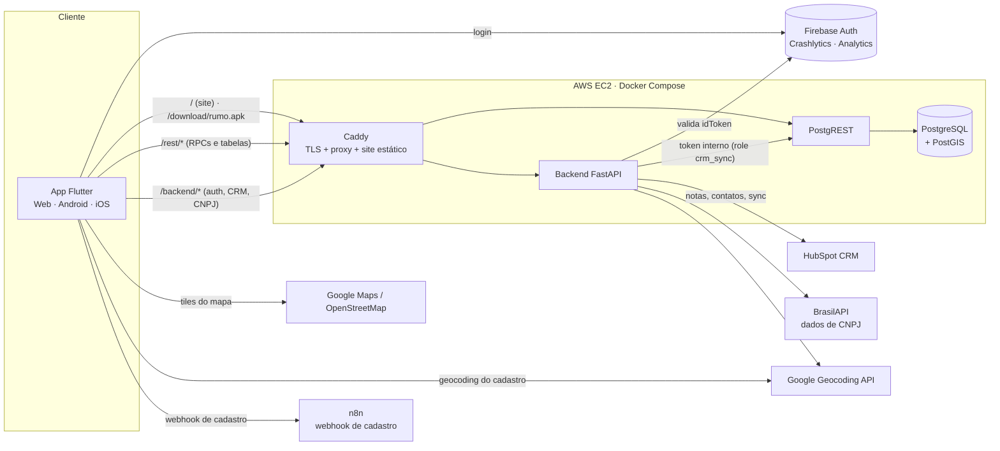
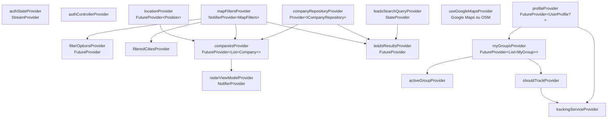
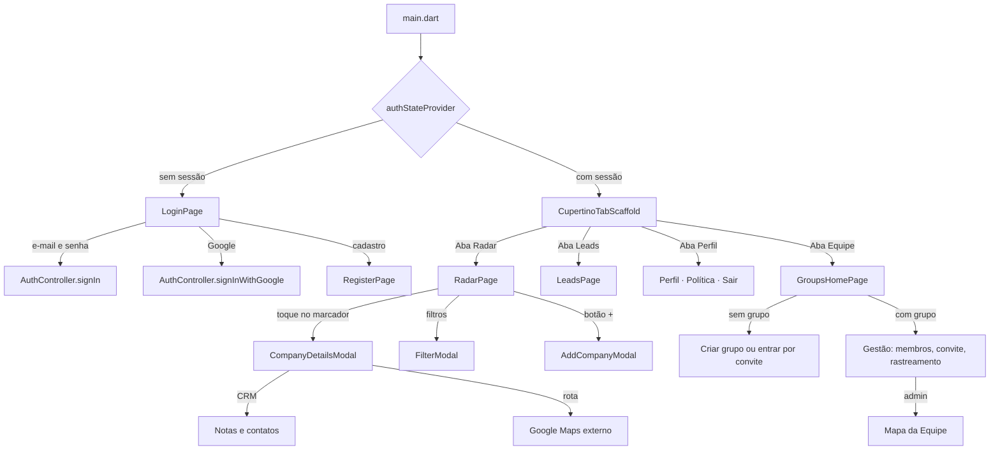
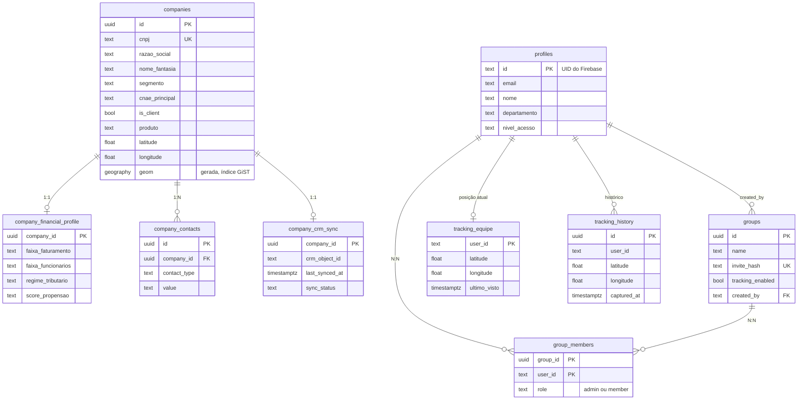

# Rumo

> **Prospecção inteligente e dinâmica baseada em geolocalização para equipes de vendas externas (Field Sales).**

O **Rumo** é uma aplicação (Web, Android e iOS) de inteligência comercial. Ele substitui planilhas estáticas por uma arquitetura geoespacial: executivos de vendas veem, filtram e interagem com leads e clientes direto no mapa, com dados públicos de CNPJ e o CRM corporativo (HubSpot) integrados.

- **Produção:** <https://rumo-app.duckdns.org> (site) · <https://rumo-app.duckdns.org/download/rumo.apk> (APK Android)
- **Versão do app:** `1.1.0+2` (`pubspec.yaml`)
- **Fluxo de branches:** as mudanças entram por PR na `dev`; a `main` recebe a `dev` quando ela está estável.

## Sumário

1. [Funcionalidades](#funcionalidades)
2. [Arquitetura geral](#arquitetura-geral)
3. [Stack](#stack)
4. [Estrutura do repositório](#estrutura-do-repositório)
5. [Frontend (Flutter)](#frontend-flutter)
6. [Backend](#backend)
7. [Banco de dados](#banco-de-dados)
8. [Variáveis de ambiente e segredos](#variáveis-de-ambiente-e-segredos)
9. [Como executar](#como-executar)
10. [Testes e qualidade](#testes-e-qualidade)
11. [Deploy e produção](#deploy-e-produção)
12. [Comandos úteis](#comandos-úteis)
13. [Solução de problemas](#solução-de-problemas)

---

## Funcionalidades

| Funcionalidade | O que faz |
|---|---|
| **Radar** (aba 1) | Mapa com as empresas dentro de um raio (padrão 5 km) ao redor do usuário, com filtros por segmento, produto, tipo (lead/cliente), UF, cidade e CNAE. Lista das 3 empresas mais próximas e contador de marcadores. A busca espacial roda no banco (PostGIS). |
| **Leads** (aba 2) | Busca textual por nome da empresa ou CNPJ, combinável com os mesmos filtros, sem depender do raio. |
| **Perfil** (aba 3) | Política de privacidade e logout ("Sair da conta"). |
| **Equipe** (aba 4) | Grupos (organizações): criar um grupo ou entrar por convite, gerenciar membros e papéis, ligar o rastreamento e abrir o **Mapa da Equipe**. |
| **Detalhes da empresa** | Dados cadastrais, financeiros e de crédito; **histórico de atividades do CRM** (notas e contatos); adicionar nota e contato direto no HubSpot; **Traçar Rota** até o cliente pelo Google Maps. |
| **Cadastro de empresa** | Fluxo de 3 passos (CNPJ → dados do sócio → dados complementares). Consulta o CNPJ na BrasilAPI, geocodifica o endereço, grava no banco e envia ao CRM por webhook. Só aparece para quem tem permissão e **só aceita cadastrar se o usuário estiver a até 2 km da empresa**. |
| **Rastreamento** | Quando o grupo do usuário liga o rastreamento, o app grava a posição a cada 5 minutos (posição atual + histórico). Só admins do grupo enxergam a posição dos membros. |
| **Sincronização com o CRM** | O CRM é a fonte das empresas: a cada 10 minutos o backend traz pro banco as empresas novas do HubSpot, já enriquecidas e geocodificadas. |
| **Fallback de mapa** | Se o Google Maps não está disponível (sem chave ou chave rejeitada), o mapa troca sozinho para o OpenStreetMap. |

Autenticação por **e-mail/senha** e por **Google**, com o Firebase Auth.

---

## Arquitetura geral



**Ideia central de segurança:** o app nunca fala direto com o banco com credenciais próprias. Ele troca o `idToken` do Firebase por um **JWT interno** (`POST /backend/auth/exchange`), e o PostgREST usa esse JWT para aplicar **Row Level Security** no Postgres (`SET ROLE`). Ver [Backend](#backend) e [Banco de dados](#banco-de-dados).

---

## Stack

| Camada | Tecnologia |
|---|---|
| UI | Flutter (Dart) + Cupertino Widgets |
| Arquitetura do app | MVVM, feature-first |
| Estado | Riverpod 2 (`Notifier`, `FutureProvider`, `StreamProvider`) |
| Autenticação | Firebase Auth (e-mail/senha e Google) + Crashlytics e Analytics |
| Mapa | Google Maps Flutter, com fallback para OpenStreetMap (`flutter_map`) |
| API de dados | PostgREST sobre PostgreSQL 16 + PostGIS 3.4 |
| Serviço auxiliar | Python 3.12 + FastAPI (padrão MVC), `httpx`, `pyjwt`, `firebase-admin` |
| Proxy | Caddy 2 (TLS automático via Let's Encrypt em produção) |
| CRM | HubSpot (API v3/v4), via `CrmService` |
| Dados de CNPJ | BrasilAPI, via `CompanyLookupService` |
| Geocodificação | Google Geocoding API, via `GeocodingService` |
| Infra | AWS: EC2 `t3.micro`, EBS, S3, Secrets Manager, SSM, CloudFormation |
| CI | GitHub Actions + SonarCloud |

Os serviços de integração têm **nomes agnósticos de fornecedor** (`CrmService`, `CompanyLookupService`, `GeocodingService`) de propósito: trocar de provedor só exige reescrever a classe, sem mudar o contrato com o app.

---

## Estrutura do repositório

```
rumo-app/
├── lib/                  # App Flutter (ver "Frontend")
├── test/                 # Testes do app (Flutter)
├── web/                  # index.html, manifest, env.js (chave do Maps no Web; não versionado)
├── android/ · ios/       # Projetos nativos
├── backend/              # Serviço FastAPI
│   ├── app/              #   código (main, config, schemas, services/, scripts/)
│   └── tests/            #   testes (pytest + respx)
├── db/
│   ├── schema/           # 001…008 *.sql — schema, geo, RLS, funções, grupos, sync CRM
│   └── seed/             # seed_companies.py (empresas fictícias)
├── infra/
│   ├── aws/              # backend-stack.yaml, artifacts-stack.yaml (CloudFormation)
│   ├── scripts/          # deploy_frontend.sh, enable_crm_sync.sh, make_token.py
│   ├── Caddyfile.local   # proxy do ambiente local
│   ├── Caddyfile.production
│   └── .env.example      # variáveis do backend
├── docker-compose.yml           # só o Flutter Web (nginx), uso local
├── docker-compose.backend.yml   # db + postgrest + backend + caddy
├── docker-compose.prod.yml      # override de produção
├── Dockerfile · nginx.conf      # build do Flutter Web em nginx (local)
├── Makefile                     # atalhos (db-up, migrate, data, deploy…)
└── .github/workflows/ci.yml
```

---

## Frontend (Flutter)

### Estrutura de `lib/`

```
lib/
├── main.dart                  # Inicialização (Firebase) + roteamento por estado de login + abas
├── firebase_options.dart      # Config do Firebase (gerada pelo `flutterfire configure`)
├── core/
│   ├── app_config.dart        # Variáveis de ambiente (--dart-define-from-file)
│   └── services/
│       ├── api_client.dart        # Cliente HTTP do backend (get/post/upsert/rpc/backend)
│       └── analytics_service.dart # Provider do FirebaseAnalytics
└── features/
    ├── auth/        # login, cadastro, política de privacidade, tradução de erros do Firebase,
    │                # authStateProvider, AuthController, profileProvider/UserProfile
    ├── map/         # Radar: radar_page, models/Company, providers (companies, location,
    │                # filtros, backend do mapa), services (company_service, tracking_service),
    │                # data/CompanyRepository, presentation (viewmodel, filtros, detalhes), widgets/OsmMap
    ├── leads/       # busca textual (leads_page + leads_search_provider)
    ├── company/     # cadastro de empresa: add_company_modal, registration_service,
    │                # crm_service, constants (listas de departamentos, setores, regimes…)
    └── groups/      # equipe: models, group_service, group_provider, telas
                     # (onboarding, gestão, home, Mapa da Equipe)
```

### MVVM com Riverpod

- **Model:** classes de dados (`Company`, `UserProfile`, `Group`, `MyGroup`, `GroupMember`, `TrackingPoint`).
- **View:** páginas e modais em Cupertino (`*_page.dart`, `*_modal.dart`, `presentation/`).
- **ViewModel:** `Notifier`/`Provider`s do Riverpod (`mapFiltersProvider`, `radarViewModelProvider`, `activeGroupProvider`…). A View só observa providers e dispara ações.

| Tipo de provider | Quando usar |
|---|---|
| `StreamProvider` | Streams contínuos (ex.: estado de autenticação) |
| `FutureProvider` | Assíncrono pontual (ex.: buscar empresas, perfil, grupos) |
| `NotifierProvider` | Estado mutável com ações (ex.: filtros, estado de UI) |
| `StateProvider` | Estado simples de UI (ex.: texto da busca) |
| `Provider` | Serviços e repositórios sem estado |
| `.family` | Providers parametrizados (ex.: notas do CRM por CNPJ, equipe por grupo) |

### Diagrama de providers



### Navegação



### Fluxo de dados do Radar

```
GPS (geolocator, com fallback)
 └─→ locationProvider
      └─→ companiesProvider ←── mapFiltersProvider (raio, segmento, UF…)
           └─→ CompanyRepository (ICompanyRepository)
                └─→ CompanyService
                     └─→ ApiClient.rpc('search_companies') ─→ Caddy ─→ PostgREST ─→ PostGIS
                          └─→ List<Company>
                               └─→ RadarPage (marcadores + lista das 3 mais próximas)
```

- Se o GPS está desligado, a permissão é negada ou o pedido demora mais de 15 s, o app usa uma **posição padrão** (Jaraguá do Sul/SC) para o mapa nunca ficar carregando.
- **Repository pattern** em `features/map`: `RadarPage → companiesProvider → ICompanyRepository → CompanyService → ApiClient`. A abstração permite trocar a fonte de dados e testar com um repositório falso.
- Os filtros (`MapFilters`) guardam segmento, produto, tipo, UF, cidade, CNAE e raio (padrão 5 km). Trocar a UF limpa a cidade.

### Autenticação no app

1. `LoginPage` autentica no **Firebase** (e-mail/senha, ou Google).
   - **Web:** `signInWithPopup` do Firebase (o `google_sign_in` no Web não devolve `idToken`).
   - **Android/iOS:** `google_sign_in` + `signInWithCredential`.
2. Após o login, `ensure_profile` (RPC) cria o perfil do usuário no banco se ele não existir.
3. `ApiClient` troca o `idToken` por um JWT interno (`/backend/auth/exchange`), **cacheia até expirar** e limpa o cache no logout.
4. Todas as chamadas seguintes (`/rest/*`, `/backend/*`) levam esse JWT.

### Permissões de cadastro

`UserProfile.canAddCompany` é `true` quando:
- `departamento` ∈ {Pré-vendas, Gestão, Administração Interna}, **ou**
- `nivelAcesso == 'admin'`.

O mesmo critério existe no banco (`can_add_company()`), que é quem de fato bloqueia a escrita. Usuários com `nivel_acesso = 'guest'` são tratados como convidados.

### Cadastro de empresa (3 passos)

1. **CNPJ:** consulta o backend (`/backend/company-lookup`, que usa a BrasilAPI), geocodifica o endereço e **valida a distância**: bloqueia se o usuário está a mais de 2 km da empresa.
2. **Sócio:** dados do contato.
3. **Complementares:** departamentos, setor, regime tributário, prioridade etc. (listas em `constants.dart`).

Ao salvar, o app faz `upsert` em `companies` (`on_conflict=cnpj`) pelo `RegistrationService.saveCompany` e envia o cadastro ao CRM pelo webhook (`URL_WEBHOOK_CRM`, um fluxo n8n).

### Equipe, grupos e rastreamento

- Qualquer usuário pode **criar um grupo** (vira admin) ou **entrar por convite** (vira membro). Um usuário pode estar em vários grupos.
- O **admin** vê o convite (e pode regenerá-lo), muda o papel dos membros (o último admin não pode ser removido) e **liga o rastreamento** do grupo.
- Com o rastreamento ligado, `TrackingService` grava a posição do usuário a cada **5 minutos** (`tracking_equipe` = posição atual, `tracking_history` = histórico). Falhas de GPS ou de rede são silenciosas: o rastreamento nunca interrompe a interface.
- Só um **admin de um grupo com rastreamento ligado** vê a posição dos membros no **Mapa da Equipe** (regra aplicada no banco, não só na tela).

### Fallback de mapa

`useGoogleMapsProvider` decide entre Google Maps e OpenStreetMap (`OsmMap`, em `flutter_map`) no Radar e no Mapa da Equipe:

- **Android/iOS:** OSM quando `GOOGLE_API_KEY` está vazia. O plugin nativo não avisa quando a chave é rejeitada, então só a ausência é detectada.
- **Web:** OSM quando `web/env.js` não tem chave, quando o script do Google não carrega, ou quando o Google chama `gm_authFailure` (chave inválida, cota, domínio não autorizado). O `web/index.html` marca `window.__gmapsFailed` e dispara o evento `gmaps-auth-failure`; a troca acontece mesmo com o mapa já na tela.

No OSM não há camada híbrida (o botão de tipo de mapa some) e os marcadores usam os mesmos assets. Os tiles vêm de `tile.openstreetmap.org` (política de uso justo; com tráfego alto, troque por um servidor de tiles próprio ou pago em `OsmMap`). Nos testes, `FixedMapBackend` fixa o backend do mapa.

---

## Backend

### Serviços (`docker-compose.backend.yml`)

| Serviço | Função |
|---|---|
| `db` | PostgreSQL 16 + PostGIS. O schema é aplicado a partir de `db/schema/*.sql` na **primeira** subida (banco vazio). |
| `postgrest` | Expõe o schema como API REST: tabelas em `/rest/<tabela>`, funções em `/rest/rpc/<função>`. |
| `backend` | FastAPI: troca de token, consulta de CNPJ, CRM e a sincronização com o CRM. |
| `caddy` | Proxy único. Local: `http://localhost:8080`. Produção: HTTPS e também serve o site e o APK. |

### Autenticação e autorização

1. O app envia o `idToken` do Firebase para `POST /backend/auth/exchange`.
2. O backend valida o token com o Firebase Admin SDK e emite um **JWT interno** (HS256, `sub` = UID do Firebase, `role` = `web_user`, expira em 1 h por padrão).
3. O **PostgREST** valida esse JWT com o mesmo segredo (`INTERNAL_JWT_SECRET`) e executa `SET ROLE` com o `role` do token. O Postgres aplica a **RLS** usando `auth_uid()` (o claim `sub`).

### Endpoints do FastAPI (`/backend/*` pelo Caddy)

| Método e rota | Função |
|---|---|
| `GET /health` | Verificação de saúde |
| `POST /auth/exchange` | Troca `Authorization: Bearer <idToken>` pelo JWT interno (401 se inválido) |
| `POST /company-lookup` | Dados cadastrais por CNPJ via BrasilAPI (404 se não existe, 502 se o provedor falha) |
| `POST /crm` | Ações no HubSpot: `getNotesWithOwners`, `getContacts`, `addContact`, `addNote` (404 se a empresa não está no CRM, 502 se o CRM falha) |

### Integrações externas

- **BrasilAPI** (`company_lookup_service.py`): pública e sem token. Devolve as chaves no formato legado (`razao`, `fantasia`, `log_tipo`, `ddd_1`/`tel_1`…) que `RegistrationService` espera.
- **HubSpot** (`crm_service.py`): localiza a empresa pelo CNPJ por uma propriedade customizada, cujo nome interno é configurável (`CRM_CNPJ_PROPERTY_NAME`, porque é criada à mão na conta do CRM).
- **Google Geocoding** (`geocoding_service.py`): converte endereço em coordenadas e devolve a precisão (`ROOFTOP`, `RANGE_INTERPOLATED`…), gravada em `companies.precisao_geocodificacao`.

### Sincronização CRM → banco

A fonte das empresas é o CRM. A cada `CRM_SYNC_INTERVAL_SECONDS` (600), um loop `asyncio` iniciado no `lifespan` do FastAPI traz pro banco as empresas **novas** do HubSpot (com CNPJ preenchido). **Nunca lista o CRM nem varre `companies`.**

- **Checagem barata:** 1 consulta à marca d'água (`crm_sync_state`) + 1 chamada ao Search do HubSpot filtrada por `hs_object_id > marca d'água` (ordenada, `limit` 100; os IDs do HubSpot são crescentes) + 1 consulta à fila `crm_sync_pending` (tabela minúscula). Sem novidade, **nada é escrito**.
- **Atraso de indexação:** o Search demora a indexar empresas novas; por isso a consulta também inclui (OR) as criadas nos últimos `CRM_SYNC_OVERLAP_MINUTES` (30), e o lote devolvido (≤ 100) é deduplicado por CNPJ com um único `SELECT` indexado.
- **ETL por empresa nova:** `CompanyLookupService` (BrasilAPI) → `GeocodingService` → `build_company_row` (o **mesmo mapeamento** do `RegistrationService.saveCompany`) → `INSERT … ON CONFLICT DO NOTHING` (nunca sobrescreve o que o app cadastrou) + vínculo em `company_crm_sync`. Empresa que o app já cadastrou só ganha o vínculo.
- **Falhas** (CNPJ não encontrado, sem coordenada, rede) vão pra `crm_sync_pending` com backoff exponencial e no máximo 5 tentativas; a marca d'água avança além delas.
- **Acesso ao banco:** pelo PostgREST (`PostgrestClient`), com token interno do papel `crm_sync` (privilégio mínimo, `db/schema/008_crm_sync.sql`). O backend não tem driver de Postgres.
- **Desligada por padrão** (`CRM_SYNC_ENABLED=false`). Para ligar em produção, use `infra/scripts/enable_crm_sync.sh` (ver [Deploy](#deploy-e-produção)).
- **Backfill:** `python -m app.scripts.crm_backfill` importa o histórico uma vez (paginado por ID, idempotente). Sem backfill, a primeira execução do job só parte do maior ID atual do CRM, sem importar nada.

### Estrutura do código (`backend/app/`)

```
main.py                  # rotas e lifespan (liga/desliga o loop do sync)
config.py                # Settings (pydantic-settings, lê o ambiente)
schemas.py · errors.py   # modelos de entrada e exceções de domínio
firebase_auth.py         # valida idToken (Admin SDK)
internal_token.py        # emite o JWT interno
services/
  auth_service.py        # troca de token
  company_lookup_service.py · crm_service.py · geocoding_service.py
  postgrest_client.py    # acesso ao banco via PostgREST (papel crm_sync)
  crm_sync_service.py    # o mini ETL e o backfill
scripts/crm_backfill.py
```

---

## Banco de dados

PostgreSQL + PostGIS, exposto pelo PostgREST. O schema fica em `db/schema/*.sql` e foi desenhado em arquivos numerados (todos idempotentes):

| Arquivo | Conteúdo |
|---|---|
| `001_init.sql` | Tabelas de empresas, perfis e rastreamento |
| `002_geo.sql` | Coluna geoespacial `geom` (gerada) e índice GiST |
| `003_roles_rls.sql` | Papéis, `auth_uid()`, `can_add_company()` e policies de RLS |
| `004_functions.sql` | `search_companies` e `get_filter_options` |
| `005_profile_functions.sql` | `ensure_profile` |
| `006_rename_crm_sync_column.sql` | `hubspot_contact_id` → `crm_object_id` (nome agnóstico) |
| `007_groups.sql` | Grupos, membros, rastreamento por grupo e suas RPCs |
| `008_crm_sync.sql` | Marca d'água, fila de pendências e papel `crm_sync` |

> **Atenção:** o Postgres só aplica esses arquivos sozinho em **banco vazio**. Em um banco existente (ex.: produção), um arquivo novo precisa ser aplicado à mão (`make migrate` no ambiente local; via SSM em produção).

### Modelo de dados



Tabelas de controle da sincronização (sem relação com as demais; só o papel `crm_sync` as acessa): `crm_sync_state` e `crm_sync_pending`.

### Tabelas

| Tabela | Uso |
|---|---|
| `companies` | Identidade, endereço e **geolocalização** das empresas — o caminho rápido da busca. `cnpj` é único. `latitude`/`longitude` são obrigatórios; `geom` é uma coluna gerada (`geography(Point, 4326)`) com índice GiST. Guarda também `is_client`, `produto`, `segmento`, `cnae_principal`, `porte`, `situacao`, `precisao_geocodificacao` etc. |
| `company_financial_profile` | Crédito e score (faixas de faturamento e de funcionários, regime tributário, dívida ativa, saúde tributária, score de propensão), 1:1 com `companies`. Só é consultada no detalhe. |
| `company_contacts` | Telefones, e-mails e redes sociais secundários (`phone`, `email`, `linkedin`, `instagram`, `facebook`, `twitter`), 1:N. |
| `company_crm_sync` | Vínculo e status de sincronização com o CRM (`crm_object_id`, `last_synced_at`, `sync_status`). |
| `profiles` | Perfil do usuário. `id` é o **UID do Firebase** (texto, não UUID), com `nome`, `departamento` e `nivel_acesso` (`user`, `admin`, `guest`). |
| `tracking_equipe` | Posição **atual** de cada usuário (upsert por `user_id`). |
| `tracking_history` | Histórico de posições (só inserção). |
| `groups` | Grupos. `invite_hash` é único e **não pode ser lido** pelo cliente; `tracking_enabled` liga o rastreamento do grupo. |
| `group_members` | Participação N:N entre usuários e grupos, com `role` (`admin` ou `member`). |
| `crm_sync_state` | Marca d'água da sincronização: maior ID de empresa do CRM já processado, com `last_run_at` e `last_status`. |
| `crm_sync_pending` | Empresas do CRM que falharam no ETL: `attempts`, `last_error`, `next_retry_at`. |

### Papéis e segurança (RLS)

| Papel | Quem usa | Observação |
|---|---|---|
| `authenticator` | Conexão do PostgREST | Só troca de papel |
| `web_anon` | Requisição sem token | Sem acesso a dados |
| `web_user` | Usuário autenticado (JWT interno) | Sujeito às policies abaixo |
| `crm_sync` | Job de sincronização | Privilégio mínimo |

`auth_uid()` devolve o UID do Firebase (claim `sub` do JWT). Todas as tabelas de negócio têm RLS ligada:

| Tabela | Leitura | Escrita |
|---|---|---|
| `profiles` | Só a própria linha | Só a própria linha |
| `companies`, `company_financial_profile`, `company_contacts` | Qualquer usuário autenticado | Só quem passa em `can_add_company()` |
| `company_crm_sync` | Qualquer usuário autenticado | Qualquer usuário autenticado |
| `tracking_equipe`, `tracking_history` | A própria linha, ou — para admins — membros de um grupo em comum **com rastreamento ligado** (`can_view_tracking`) | Só a própria linha |
| `groups`, `group_members` | Só quem é membro do grupo | **Nenhuma direta** — tudo passa pelas RPCs (`SECURITY DEFINER`) |
| `crm_sync_state`, `crm_sync_pending` | Só `crm_sync` | Só `crm_sync` |

`companies` aceita `INSERT` do papel `crm_sync` apenas com `ON CONFLICT DO NOTHING` (sem `UPDATE`): o sync nunca sobrescreve o que o app cadastrou.

### Funções (RPCs) e auxiliares

| Função | Parâmetros | O que faz |
|---|---|---|
| `search_companies` | `p_lat`, `p_lon`, `p_radius_km`, `p_query`, `p_segment`, `p_product`, `p_state`, `p_city`, `p_cnae`, `p_is_client`, `p_limit` | **Uma única busca** que unifica raio (PostGIS `ST_DWithin`), texto (razão social, fantasia ou CNPJ) e filtros. Ordena por distância e devolve `distance_km`. Faz `JOIN` com o perfil financeiro. |
| `get_filter_options` | — | Valores distintos para os filtros: segmentos, produtos, UFs, CNAEs e o mapa UF → cidades. |
| `ensure_profile` | `p_nome`, `p_departamento` | Cria (ou devolve) o perfil do usuário autenticado. |
| `create_group` | `p_name` | Cria o grupo com um convite aleatório e torna o chamador admin. |
| `join_group_by_hash` | `p_hash` | Entra no grupo como membro (idempotente). Erro se o convite for inválido. |
| `regenerate_group_invite` / `get_group_invite` | `p_group_id` | Só admin: gera um convite novo / relê o atual (devolve nulo se não for admin). |
| `set_member_role` | grupo, usuário, papel | Muda o papel; **impede deixar o grupo sem admin**. |
| `set_group_tracking` | `p_group_id`, `p_enabled` | Liga ou desliga o rastreamento do grupo. |
| `list_group_members` | `p_group_id` | Membros com nome e e-mail (uma RPC, e não uma view, porque a RLS de `profiles` esconderia os colegas). |
| `list_group_tracking` | `p_group_id` | Posições da equipe: só admin e só com rastreamento ligado. |
| `can_add_company`, `is_group_member`, `is_group_admin`, `can_view_tracking`, `auth_uid` | — | Auxiliares usadas pelas policies. |

O formato de retorno de `search_companies` usa os mesmos nomes de coluna que `Company.fromJson`, então o model Dart não precisa de adaptação.

### Dados de teste

`make data [COUNT=40]` popula o banco local com empresas fictícias num raio de 10 km de Jaraguá do Sul/SC (`db/seed/seed_companies.py`).

---

## Variáveis de ambiente e segredos

Nenhum destes arquivos é versionado (o repositório é público).

### App Flutter — `.env` (raiz)

Injetado no build por `--dart-define-from-file=.env` e lido por `AppConfig` (`lib/core/app_config.dart`).

| Variável | Uso |
|---|---|
| `API_BASE_URL` | URL base do backend (Caddy). Padrão `http://localhost:8080` |
| `SERVER_WEB_CLIENT_ID` | OAuth Google (client Web / servidor) |
| `CLIENT_ID` | OAuth Google (client iOS) |
| `GOOGLE_API_KEY` | Google Maps + Geocoding. Vazia ⇒ fallback para OSM |
| `URL_WEBHOOK_CRM` | Webhook chamado após o cadastro de empresa |

### Chaves nativas e do Web (fora do `.env`, porque o código nativo não lê `--dart-define`)

| Arquivo | Variável | Uso |
|---|---|---|
| `web/env.js` (copie de `web/env.js.example`) | `window.GOOGLE_MAPS_API_KEY` | Chave do Maps no Web. Vazia ⇒ fallback para OSM |
| `android/secrets.properties` (copie de `…/secrets.properties.example`) | `GOOGLE_MAPS_API_KEY` | Vai pro manifesto Android. Sem ela, o mapa do APK fica em branco |
| `ios/Flutter/Secrets.xcconfig` (copie de `…/Secrets.xcconfig.example`) | `GOOGLE_MAPS_API_KEY` | Vai pro `Info.plist` do iOS |
| `android/key.properties` + keystore | `storePassword`, `keyPassword`, `keyAlias`, `storeFile` | Assinatura do APK de release |

### Backend — `infra/.env` (copie de `infra/.env.example`)

| Variável | Uso |
|---|---|
| `POSTGRES_PASSWORD`, `AUTHENTICATOR_PASSWORD` | Senhas do banco (sem padrão: o compose falha se faltarem) |
| `INTERNAL_JWT_SECRET` | Segredo do JWT interno, **mínimo 32 bytes** (`openssl rand -hex 32`). Compartilhado com o PostgREST |
| `FIREBASE_PROJECT_ID` | Projeto Firebase |
| `infra/firebase-service-account.json` | Service account do Firebase (arquivo, não variável) |
| `CRM_TOKEN` | Token do app privado do HubSpot |
| `CRM_CNPJ_PROPERTY_NAME` | Nome **interno** da propriedade de CNPJ no HubSpot (padrão `cnpj`) |
| `CRM_SYNC_ENABLED` | Liga o job de sincronização (padrão `false`) |
| `CRM_SYNC_INTERVAL_SECONDS` | Intervalo do job (padrão `600`) |
| `GEOCODING_API_KEY` | Chave de **servidor** da Google Geocoding API |

Opções avançadas do backend, com padrão no `config.py`: `CRM_SYNC_OVERLAP_MINUTES` (30), `CRM_SYNC_BATCH_SIZE` (100), `POSTGREST_URL`, `INTERNAL_JWT_TTL_SECONDS` (3600) e `FIREBASE_SERVICE_ACCOUNT_PATH`.

---

## Como executar

### Pré-requisitos

- [Flutter SDK](https://docs.flutter.dev/get-started/install) (o projeto usa Dart `^3.5.4`; o CI e o `Dockerfile` usam a versão estável recente)
- [Docker](https://www.docker.com/) + Docker Compose (backend local)
- Projeto Firebase configurado (Auth, Crashlytics, Analytics) e chaves do Google Maps/Geocoding
- Para a sincronização com o CRM: um token do HubSpot. A consulta de CNPJ usa a BrasilAPI, pública e sem chave
- **iOS:** um Mac com Xcode, idealmente com um **iPhone físico** (o simulador não reproduz fielmente a localização em segundo plano)
- **Android:** Android Studio (SDK) e um emulador ou dispositivo com depuração USB

### 1. Backend local

```bash
cp infra/.env.example infra/.env   # preencha os segredos antes de tudo
make db-up                          # sobe db + postgrest + backend + caddy (http://localhost:8080)
make data                           # opcional: empresas fictícias para testar o radar
```

O schema (`db/schema/*.sql`) é aplicado na primeira subida. Para recomeçar do zero: `make db-reset`.

### 2. Configurar o app

Crie o `.env` da raiz (veja [Variáveis de ambiente](#variáveis-de-ambiente-e-segredos)) e as chaves nativas da plataforma que for usar.

### 3. Rodar

```bash
# Web
flutter run -d chrome --dart-define-from-file=.env

# Android / iOS (dispositivo ou emulador já selecionado; `flutter devices` lista)
flutter run --dart-define-from-file=.env
```

**Android:** o app pede `ACCESS_FINE_LOCATION`, `ACCESS_COARSE_LOCATION` e `ACCESS_BACKGROUND_LOCATION` em tempo de execução.

**iOS** — passo extra, porque o código nativo não lê `--dart-define`:
1. Copie `ios/Flutter/Secrets.xcconfig.example` para `ios/Flutter/Secrets.xcconfig`.
2. Preencha `GOOGLE_MAPS_API_KEY` com o mesmo valor do `GOOGLE_API_KEY`.
3. `cd ios && pod install` antes do primeiro build.

### Apontando para o backend da AWS

Use `--dart-define=API_BASE_URL=https://rumo-app.duckdns.org` depois do `--dart-define-from-file`. Como o backend de produção não libera CORS para `localhost`, no Web rode um Chrome sem web security:

```bash
flutter run -d chrome --web-browser-flag "--disable-web-security" \
  --dart-define-from-file=.env --dart-define=API_BASE_URL=https://rumo-app.duckdns.org
```

### Gerar o APK

```bash
flutter build apk --debug   --dart-define-from-file=.env
flutter build apk --release --dart-define-from-file=.env   # exige android/key.properties + keystore
```

Saída em `build/app/outputs/flutter-apk/`. Sem `key.properties` não há APK de release assinado.

### Flutter Web em Docker (local)

```bash
docker-compose up --build     # compila o Flutter Web com o .env e serve com nginx
```

As portas ficam definidas em `docker-compose.yml` e `nginx.conf`. Em produção o site é servido pelo Caddy, não por esse nginx.

---

## Testes e qualidade

### Flutter

```bash
flutter analyze
flutter test
flutter test --coverage              # gera coverage/lcov.info
dart format --output=none --set-exit-if-changed .   # o CI exige código formatado
```

Os testes ficam em `test/`, espelhando `lib/` (modelos, providers, serviços e widgets). Os doubles ficam em `test/helpers/`: `FakeCompanyRepository`, `FakeGoogleMapsPlatform` e `FixedMapBackend`, que fixa Google Maps ou OSM sem depender de chave nem do navegador.

### Backend

```bash
cd backend
pip install -r requirements-dev.txt
pytest                                # pytest + respx (mocka o HTTP das integrações)
```

### CI (`.github/workflows/ci.yml`)

A cada push em `main`/`dev` e em PRs: instala o Flutter, confere a **formatação**, roda `flutter analyze` e `flutter test`, e um job do **SonarCloud** roda os testes com cobertura. **O CI não roda os testes do backend** (`pytest`).

Cobertura medida em 01/11/2026: Flutter ≈ 83% das linhas e backend ≈ 97%. Meça de novo antes de citar esses números.

---

## Deploy e produção

### Infraestrutura (AWS, região **us-east-1**)

- **Backend:** 1 instância EC2 `t3.micro` (com swap de 1 GB) + volume EBS dedicado aos dados + IP elástico + Security Group só com 80/443. Provisionada por `infra/aws/backend-stack.yaml` (stack `rumo-app-backend`). Acesso administrativo **só por SSM**, sem SSH.
- **Segredos:** AWS Secrets Manager — `rumo-app/backend-env` (vira o `infra/.env` da instância) e `rumo-app/firebase-service-account`.
- **TLS:** automático (Let's Encrypt) para `rumo-app.duckdns.org`, um subdomínio DuckDNS (parâmetro `DomainName` do template).
- **Artefatos do frontend:** bucket S3 privado, criado pela stack **separada** `infra/aws/artifacts-stack.yaml` (stack `rumo-app-artifacts`), que não mexe na instância.

```bash
# Segredos (uma vez, antes do primeiro deploy)
aws secretsmanager create-secret --region us-east-1 --name rumo-app/backend-env --secret-string file://infra/.env.json
aws secretsmanager create-secret --region us-east-1 --name rumo-app/firebase-service-account --secret-string file://infra/firebase-service-account.json

# Provisiona a infra do backend (EC2 + EIP + volume + Security Group)
aws cloudformation deploy --region us-east-1 --template-file infra/aws/backend-stack.yaml \
  --stack-name rumo-app-backend --capabilities CAPABILITY_NAMED_IAM \
  --parameter-overrides VpcId=<vpc-id> SubnetId=<subnet-id> AvailabilityZone=<az>

# Bucket de artefatos (uma vez)
aws cloudformation deploy --region us-east-1 --template-file infra/aws/artifacts-stack.yaml \
  --stack-name rumo-app-artifacts --capabilities CAPABILITY_NAMED_IAM
```

> O seu AWS CLI pode ter outra região como padrão. O `Makefile` já usa `AWS_REGION` (padrão `us-east-1`); em comandos `aws` manuais, passe `--region us-east-1`.

### Atualizar o backend

A EC2 **acompanha a branch `dev`**: o `UserData` a clona no boot e o `make deploy` faz `git pull` nela. Mudanças de infra/compose só chegam à produção depois de mergeadas na `dev`.

```bash
make deploy INSTANCE_ID=<instance-id>   # git pull + docker compose up -d --build, via SSM
```

O compose de produção (`docker-compose.backend.yml` + `docker-compose.prod.yml`) publica só 80/443 pelo Caddy; banco, PostgREST e backend ficam sem porta exposta.

### Frontend e APK

O Caddy (`infra/Caddyfile.production`) serve, no **mesmo domínio** da API:

| Caminho | Conteúdo |
|---|---|
| `/` | Flutter Web (SPA: rota desconhecida cai no `index.html`) |
| `/download/rumo.apk` | APK Android assinado (link público) |
| `/rest/*`, `/backend/*` | PostgREST e backend |

Como site e API têm a mesma origem, **não há CORS em produção**. Os arquivos ficam no volume EBS (`/mnt/rumo-data/web` e `/mnt/rumo-data/downloads`, montados somente-leitura no Caddy) e chegam do bucket S3. O build é feito **localmente**, porque a `t3.micro` não aguenta compilar Flutter.

```bash
make deploy-web INSTANCE_ID=<id> ARTIFACTS_BUCKET=<bucket>   # build web -> S3 -> sync na EC2 (SSM)
make deploy-apk INSTANCE_ID=<id> ARTIFACTS_BUCKET=<bucket>   # build do APK assinado -> S3 -> /download/rumo.apk
```

Pré-requisitos do build (todos fora do git): `.env`, `web/env.js`, `android/key.properties` + keystore e `android/secrets.properties`. O script é `infra/scripts/deploy_frontend.sh`.

**Ordem para subir uma versão:** merge na `dev` → `make deploy` → `make deploy-web` e/ou `make deploy-apk`.

**Configuração manual fora do código:**
- Firebase → Authentication → *Authorized domains* precisa incluir `rumo-app.duckdns.org`, senão o login com Google no site falha.
- Login com Google no APK: cadastre o **SHA-1** do keystore no app Android do Firebase e baixe o `google-services.json` de novo (ele precisa ter o `oauth_client` preenchido).
- A chave do Maps precisa aceitar o domínio (Web) e o pacote + SHA-1 (Android).

### Ligar a sincronização com o CRM em produção

O job vem **desligado**. `infra/scripts/enable_crm_sync.sh` (com `INSTANCE_ID` definido) faz a ativação em etapas, nesta ordem:

| Etapa | O que faz |
|---|---|
| `migrate` | Aplica `008_crm_sync.sql` no banco de produção |
| `config` | Grava `GEOCODING_API_KEY` (e `CRM_SYNC_ENABLED=false`) no Secrets Manager e atualiza o `infra/.env` da EC2 (requer `GEOCODING_API_KEY` no ambiente) |
| `backfill` | Importa o histórico do CRM, uma vez (idempotente) |
| `enable` | Liga o job (`CRM_SYNC_ENABLED=true`) e reinicia o backend |
| `status` | Só leitura: logs, marca d'água, pendências e contagens |

`DRY_RUN=1` mostra o que seria feito sem executar. Nenhum segredo é impresso. **Ligue só depois do `backfill`**, senão a empresa que já existe no CRM fica de fora.

### Migrações em produção

Arquivos novos em `db/schema/` **não são aplicados sozinhos** em um banco que já existe. Aplique à mão, via SSM, antes de ligar o recurso que depende deles (foi o caso da `008`).

---

## Comandos úteis

```bash
# App
flutter run -d chrome --dart-define-from-file=.env     # Web
flutter run --dart-define-from-file=.env               # Android/iOS
flutter build web --release --dart-define-from-file=.env
flutter build apk --release --dart-define-from-file=.env
flutter analyze && flutter test

# Backend local (Makefile)
make db-up        # sobe db + postgrest + backend + caddy
make db-down      # derruba os containers, mantém os dados
make db-reset     # apaga os dados e reaplica o schema do zero
make migrate      # reaplica db/schema/*.sql manualmente (idempotente)
make psql         # shell psql dentro do container do banco
make token UID=x  # gera um JWT de teste
make data         # popula empresas fictícias (COUNT=40)

# Produção (requerem AWS CLI e INSTANCE_ID; os de frontend também ARTIFACTS_BUCKET)
make deploy       # atualiza o backend na EC2
make deploy-web   # publica o Flutter Web
make deploy-apk   # publica o APK
```

---

## Solução de problemas

| Sintoma | Causa provável e o que fazer |
|---|---|
| Mensagem vermelha "Erro ao buscar empresas" | O app não alcança o backend: `API_BASE_URL` errada ou o backend parado (`make db-up`). Confira com `curl <API_BASE_URL>/rest/`. |
| Tela em branco ao abrir a URL do `flutter run -d chrome` em outra aba | Nesse modo o app em debug só inicia na janela que o Flutter abriu. Use essa janela, ou rode com `-d web-server --web-port 5050`. |
| No Web contra a AWS: login passa, mas os dados não carregam | CORS: o backend de produção não libera `localhost`. Use um Chrome com `--disable-web-security` (ver [Como executar](#como-executar)). |
| Mapa em branco no APK | Falta `android/secrets.properties` (chave do Maps) ou a chave não aceita o app (pacote + SHA-1). |
| Mapa mostra OpenStreetMap em vez do Google | Comportamento esperado do fallback: chave ausente, inválida ou domínio não autorizado. |
| Login com Google falha no site | O domínio não está em Firebase → Authentication → *Authorized domains*. |
| Login com Google falha no APK (`ApiException: 10`) | SHA-1 do keystore não cadastrado no Firebase ou `google-services.json` desatualizado. |
| `make deploy` falha ou não acha a instância | Região errada: a stack roda em `us-east-1`. |
| Empresa do CRM não apareceu no banco | O job está desligado, ou a empresa não tem a propriedade de CNPJ. Veja `enable_crm_sync.sh status` e a fila `crm_sync_pending`. |
| `GEOCODING_API_KEY` com `REQUEST_DENIED` | A chave tem restrição de site/app. A do servidor deve ser restrita por IP e por API, não por referrer. |
| Gradle falha com erros de lock ou escrita | Disco cheio: libere espaço (`flutter clean`, cache do Gradle/Xcode). |
